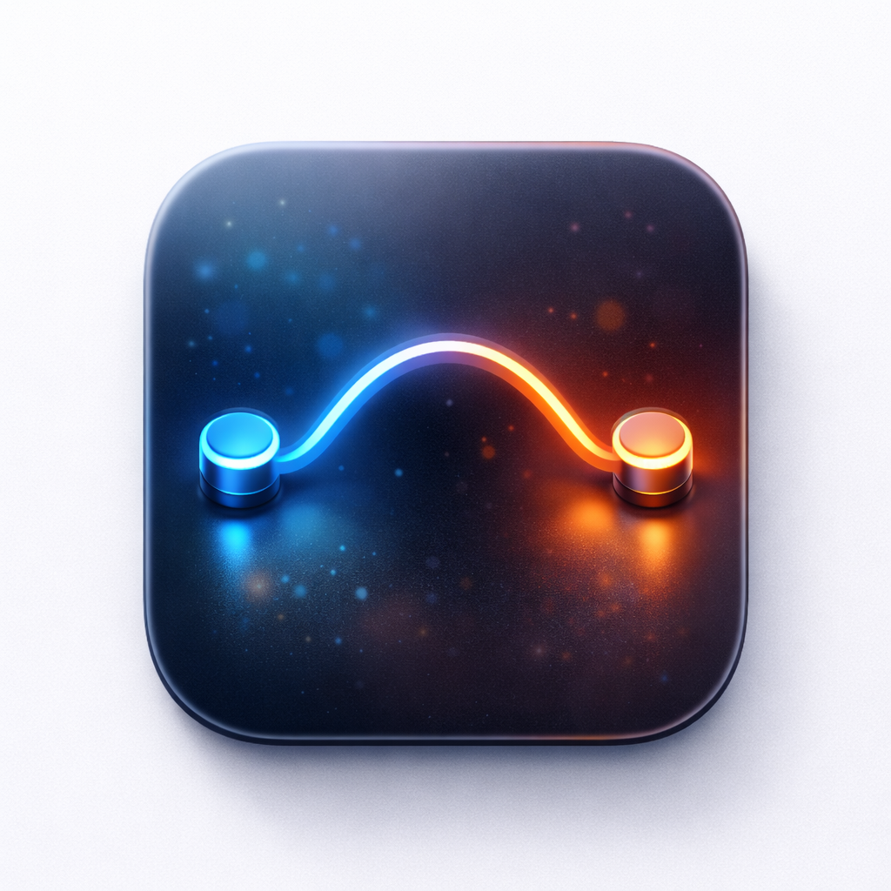

<p align="center">
  
</p>

<h1 align="center">SoundBridge</h1>

<p align="center">
  A free, open-source macOS system-wide volume controller for HDMI and DisplayPort monitors.
</p>

<p align="center">
  <a href="https://github.com/chenjy16/SoundBridge/releases">Download</a> · 
  <a href="#how-it-works">How It Works</a> · 
  <a href="#building-from-source">Build</a>
</p>

---

## Why SoundBridge?

Many external monitors connected via HDMI or DisplayPort have fixed-volume audio output — macOS shows the volume slider grayed out. SoundBridge solves this by inserting a virtual audio driver between your apps and the physical device, giving you full software volume control through the menu bar.

No kernel extensions. No background daemons you can't see. Just a lightweight menu bar app.

## Features

- System-wide volume control for fixed-volume HDMI/DisplayPort audio
- Menu bar app with volume slider and mute toggle
- Keyboard volume keys work as expected
- 10-band parametric EQ with preset support
- Automatic device detection and hot-plug support
- Universal binary (Apple Silicon + Intel)
- Guided onboarding that points at the official installer package
- Unsigned and unnotarized — no code signature of any kind (see [Installation](#installation) and [Known limitations](docs/risks/Known-Limitations.md))

## Requirements

- macOS 13.0+ (Ventura) or later
- HDMI or DisplayPort audio output

## Installation

Two files are published, and they install different things:

| File | What it does |
|---|---|
| `SoundBridge-1.2.0.pkg` | Installs the app **and** the HAL driver. This is the supported path for a first install and for any upgrade. |
| `SoundBridge-1.2.0.dmg` | Replaces the app only. It never touches `/Library/Audio/Plug-Ins/HAL/`. |

1. Quit SoundBridge if it is running (the installer does not check).
2. Open `SoundBridge-1.2.0.pkg` from [Releases](https://github.com/chenjy16/SoundBridge/releases) and approve the administrator prompt. That is the installer's own authorization; it is the only thing that writes to the HAL directory, and it replaces the driver as a transaction with a backup and a rollback.
3. Launch `SoundBridge.app`. Onboarding reads the installed driver and shows success only when it matches this build. The app does not install anything itself.
4. Choose **SoundBridge** as the output device, then pick the physical HDMI/DisplayPort device in the menu bar.

Upgrading from 1.1.x **must** use the PKG: the shared-memory protocol changed to `0x00020200`, so an old driver with a new app produces no audio.

> **First launch**: nothing in this release is signed. There is no Developer ID
> signature, no ad-hoc signature, no PKG signature and no notarization, so Gatekeeper
> refuses both the app and the package by design (`spctl` reports
> `rejected / source=no usable signature`). Approval is manual: try to open the app,
> then go to **System Settings → Privacy & Security**, scroll down and click
> **Open Anyway**. Older systems also accept right-click → **Open**. Do not disable
> Gatekeeper or SIP. If your organisation enforces a managed policy that forbids
> unsigned software, this release cannot be installed at all.
>
> **Driver loading is not verified everywhere.** The unsigned HAL driver is accepted by
> the HAL directory copy step, but whether `coreaudiod` loads an unsigned driver from
> `/Library/Audio/Plug-Ins/HAL` has not been verified on macOS 14 or on Intel Macs. See
> [Known limitations](docs/risks/Known-Limitations.md).

Full steps, troubleshooting and the data a removal keeps are in [docs/INSTALLATION_GUIDE.md](docs/INSTALLATION_GUIDE.md).

### Uninstalling

Menu bar → **Uninstall Driver**, or `tools/uninstall_driver.sh` (add `--dry-run` first). Both run the same policy (`DriverUninstallPolicy`): they read the bundle identifier and refuse anything that is not `com.soundbridge.driver`, stop the Host through its supervisor, remove exactly one constant path, never touch `/tmp` or another vendor's HAL bundle, and never restart `coreaudiod`. EQ settings, volume state, logs and the app itself are kept.

### Updating

**Sparkle is not enabled in this build** (`SUPublicEDKey` is empty), so the app does not update itself. Upgrades are a downloaded PKG, as above. The driver never updates on its own.

Onboarding runs once. If a later release changes the driver's shared-memory protocol, the app detects the mismatch at launch, tells you which driver version it needs and which one is installed, and points at the [releases page](https://github.com/chenjy16/SoundBridge/releases) — it does not offer an in-app upgrade, and it will not re-run the install step by itself.

## How It Works

SoundBridge uses a four-component architecture:

```
┌─────────────────┐     ┌──────────────────────┐     shared memory     ┌─────────────────┐     ┌─────────────────┐
│   Menu Bar App   │────▶│   HAL Virtual Driver  │◀──────────────────▶│   Host Engine    │────▶│  Physical Device │
│   (SwiftUI)      │     │   (C++ CoreAudio)     │    /tmp/soundbridge  │   (Swift)        │     │  (HDMI/DP)       │
└─────────────────┘     └──────────────────────┘                      └─────────────────┘     └─────────────────┘
       UI controls              Proxy device                            DSP + rendering
       volume/mute              captures audio                          gain + EQ
```

### Components

| Component | Language | Location | Role |
|-----------|----------|----------|------|
| App | Swift / SwiftUI | `apps/mac/SoundBridgeApp/` | Menu bar UI, onboarding, driver installer, volume control via CoreAudio API |
| Driver | C++ | `packages/driver/` | HAL plugin that creates virtual proxy devices, captures audio into shared memory ring buffers |
| Host | Swift | `packages/host/` | Background process that reads from shared memory, applies gain/DSP, renders to physical hardware |
| DSP | C/C++ | `packages/dsp/` | 10-band parametric EQ engine with C ABI, used by Host via Objective-C++ bridge |

### Audio Chain

1. macOS routes audio to the SoundBridge proxy device (appears as "Device via SoundBridge")
2. The HAL driver writes audio frames into a shared memory ring buffer (`/tmp/soundbridge-<uid>`)
3. The Host process reads from the ring buffer, applies software gain (from the volume slider) and optional EQ
4. Processed audio is rendered to the real physical output device

Volume control uses CoreAudio's `kAudioDevicePropertyVolumeScalar` on the proxy device. The driver stores the value in shared memory, and the Host maps that raw slider travel onto a linear-in-decibel taper (48 dB) before applying it as gain, with smoothing to avoid clicks. Because the taper is linear in dB, every volume-key press changes loudness by the same amount.

## Project Structure

```
SoundBridge/
├── apps/mac/SoundBridgeApp/    # SwiftUI menu bar application
│   └── Sources/
│       ├── App/                # App entry point, lifecycle
│       ├── Views/              # MenuBarView, SettingsWindow, Onboarding
│       ├── Services/           # VolumeController, IPCController, DriverInstaller
│       └── Resources/          # Icons, fonts, images
├── packages/
│   ├── driver/                 # CoreAudio HAL virtual driver (C++)
│   │   ├── src/Plugin.cpp      # Driver runtime logic
│   │   ├── include/            # RFSharedAudio.h (shared memory protocol)
│   │   └── vendor/libASPL/     # HAL plugin C++ wrapper
│   ├── host/                   # Background audio host (Swift)
│   │   └── Sources/
│   │       └── SoundBridgeHost/
│   │           ├── Audio/      # AudioRenderer, AudioEngine
│   │           ├── Devices/    # DeviceDiscovery, DeviceRegistry
│   │           └── Services/   # SharedMemoryManager, DSPProcessor
│   └── dsp/                    # DSP engine (C/C++)
│       ├── include/            # Public C API
│       ├── src/                # Biquad filters, limiter, engine
│       ├── bridge/             # Objective-C++ wrapper for Swift
│       └── tests/              # 33 automated tests
├── tools/                      # Build, sign, verify, PKG and DMG scripts
├── Makefile                    # Development shortcuts
└── .github/workflows/          # Release CI (build + ad-hoc sign + PKG/DMG)
```

## Building from Source

### Prerequisites

- macOS 13.0 (Ventura) or later
- Xcode Command Line Tools (`xcode-select --install`)
- CMake (`brew install cmake`)
- Git (for submodule management)

检查依赖是否就绪：

```bash
make install-deps
```

### Clone & Initialize

项目依赖 git submodule（HAL 驱动使用的 [libASPL](https://github.com/gavv/libASPL) 库），克隆后必须初始化：

```bash
git clone https://github.com/chenjy16/SoundBridge.git
cd SoundBridge
git submodule update --init --recursive
```

> ⚠️ 如果跳过 submodule 初始化，构建 HAL Driver 时会报错：`does not contain a CMakeLists.txt file`。

### Quick Build

```bash
# 构建所有组件（DSP、Driver、Host、App），输出 universal binary（arm64 + x86_64）
make build

# 运行应用
make run
```

`make build` 会自动完成以下步骤：
1. 从 git tag 更新版本号到各组件的 Info.plist / CMakeLists.txt
2. 构建 DSP 库（C++，universal）
3. 构建 HAL 虚拟驱动（C++，universal，依赖 libASPL）
4. 构建 Audio Host（Swift，universal）
5. 构建 Menu Bar App（Swift，universal）
6. 创建 `dist/SoundBridge.app` 应用包

构建产物位于 `dist/SoundBridge.app`。

### 常用命令

| 命令 | 说明 |
|------|------|
| `make build` | 构建所有组件（DSP、Driver、Host、App） |
| `make bundle` | 仅创建 .app 包（需先 build） |
| `make run` | 运行已构建的应用 |
| `make dev` | 重置状态 + 构建 + 运行（完整的开发流程，会触发 onboarding） |
| `make clean` | 清理所有构建产物 |
| `make rebuild` | clean + 完整重新构建 |
| `make quick` | 仅重新构建 Swift 代码（更快的迭代速度） |
| `make test` | 运行 DSP 测试套件 |
| `make update-version` | 从 git tag 更新各组件版本号 |

### 打包与分发

```bash
# 断言 .app 未签名（无 bundle 封印、无签名身份、SUPublicEDKey 为空）
make verify

# 断言 app + PKG + DMG 全部未签名，且未发布 appcast
make verify-unsigned

# 创建 DMG 安装包（含拖拽到 Applications 的布局）
make dmg

# 完整发布流程：构建 → 未签名断言 → DMG
make full-release
```

| 命令 | 说明 |
|------|------|
| `make verify` | Assert the `.app` bundle is unsigned (no seal, no identity, empty `SUPublicEDKey`) |
| `make verify-unsigned` | Assert app, PKG and DMG are unsigned and that no appcast exists |
| `make dmg` | Create the DMG with a drag-to-Applications layout |
| `make release` | Build + assert unsigned |
| `make full-release` | Build + assert unsigned + DMG (full pipeline) |
| `make test-release` | Open the release build |
| `make sign` | Refuses: signing is not part of this project (exit 2) |

> This product ships **unsigned: no Developer ID, no ad-hoc signature, no PKG
> signature, no notarization**. `make sign` and `tools/notarize.sh` exist only to fail
> loudly with an explanation; they produce nothing. The only signature inside a built
> binary is the ad-hoc CodeDirectory `ld64` writes into every Mach-O, which Apple
> silicon requires in order to load the code at all — it carries no certificate and no
> TeamIdentifier. Users approve the first launch once, as described in
> [Installation](#installation).

### 手动构建各组件

如果需要单独构建某个组件：

```bash
# 1. DSP 库（C++）
cmake -S packages/dsp -B packages/dsp/build -DCMAKE_BUILD_TYPE=Release \
  -DCMAKE_OSX_ARCHITECTURES="arm64;x86_64"
cmake --build packages/dsp/build

# 2. HAL 驱动（C++，依赖 libASPL submodule）
cmake -S packages/driver -B packages/driver/build -DCMAKE_BUILD_TYPE=Release \
  -DCMAKE_OSX_ARCHITECTURES="arm64;x86_64"
cmake --build packages/driver/build

# 3. Host 引擎（Swift）
cd packages/host && swift build -c release

# 4. Menu Bar 应用（Swift）
cd apps/mac/SoundBridgeApp && swift build -c release
```

### 构建产物

```
dist/
└── SoundBridge.app/
    └── Contents/
        ├── MacOS/
        │   ├── SoundBridgeApp          # 主程序（Menu Bar 应用）
        │   └── SoundBridgeHost         # 后台音频引擎
        ├── Resources/
        │   ├── SoundBridgeDriver.driver/  # HAL 虚拟驱动
        │   └── ...                        # 图标、字体等资源
        └── Info.plist
```

## Release Pipeline

Releases are automated via GitHub Actions. When you publish a release with a `vX.Y.Z` tag:

1. Checks that `VERSION`, the tag and every component agree, and that the shared-memory
   protocol header is single-sourced
2. Builds all components as universal binaries (arm64 + x86_64)
3. Creates the `.app` bundle — **no signing step exists**
4. Asserts the bundle is unsigned (`tools/verify_signatures.sh`), then builds the
   installer PKG (`tools/build_installer_pkg.sh`) and the DMG (`tools/create_dmg.sh`)
5. Asserts the driver, package and image structures, and that all three artifacts are
   still unsigned (`tools/verify_unsigned_release.sh`)
6. Uploads the PKG, DMG, checksums and the two documents to the GitHub Release

No secrets are required. There is no certificate, no notary credential and no Sparkle
key pair; the workflow passes no signing key to the build and refuses to run if any
artifact comes out signed. `tools/create_app_bundle.sh` fails outright if
`SPARKLE_ED_PUBLIC_KEY` is inherited from the environment, so an old secret cannot
silently re-enable the update path.

### Auto-updates (not supported in 1.2.0)

**There is no update channel.** The bundle ships an empty `SUPublicEDKey`, no
`appcast.xml` is generated or uploaded, and `tools/generate_appcast.sh` refuses to run.
`SUFeedURL` still points at
`https://github.com/chenjy16/SoundBridge/releases/latest/download/appcast.xml`, which is
never published, so the updater cannot start even if the key were filled in by mistake.
Upgrades are a downloaded PKG. `Sparkle.framework` stays in the bundle only because
`SoundBridgeApp` links it through `@rpath`; removing it would stop the app from
launching.

## Contributing

Contributions are welcome. The codebase is structured so each component can be built and tested independently:

- DSP changes: `make test` runs the C++ test suite
- Driver changes: rebuild the driver, then log out and back in (or run `sudo killall coreaudiod` yourself) to have coreaudiod reload it. Nothing in the product restarts a daemon for you.
- Host/App changes: `make quick` for fast Swift-only rebuilds

## License

MIT
