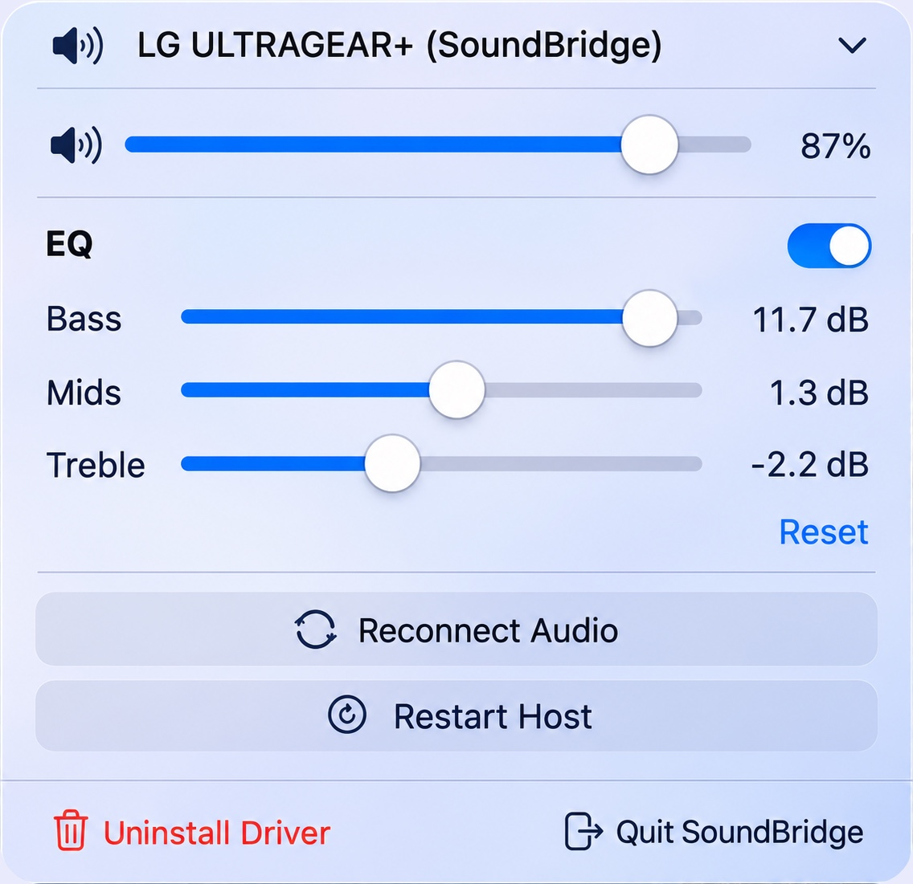
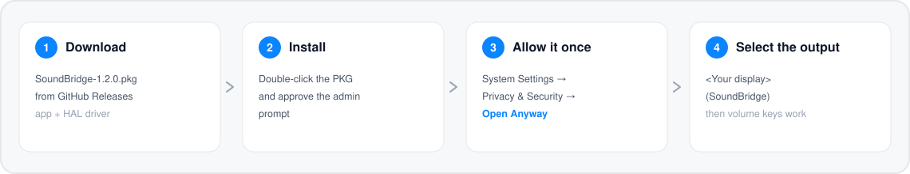
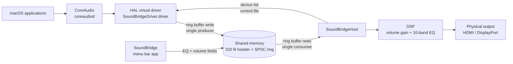

<p align="center">
  
</p>

<p align="center">
  <sub>Captured on the 1.2.0 validation machine: an LG UltraGear over DisplayPort, with its (SoundBridge) proxy device selected as the output.</sub>
</p>

<h1 align="center">SoundBridge</h1>

<p align="center">
  <b>Volume control and EQ for HDMI / DisplayPort displays on macOS</b><br>
  <sub>1.2.0 · macOS 13+ · universal · unsigned build: not notarized, no auto-update</sub>
</p>

<p align="center">
  <a href="https://github.com/chenjy16/SoundBridge/releases">Download</a> ·
  <a href="#install">Install</a> ·
  <a href="#why-soundbridge">Why SoundBridge?</a> ·
  <a href="#architecture">Architecture</a> ·
  <a href="#documentation">Documentation</a>
</p>

---

## What it is

A macOS menu bar app that gives HDMI and DisplayPort outputs a working volume
control and a 10-band tone stage. The system volume slider, the volume keys and
mute act on the display, and the audio is processed in software before it reaches
the physical device. No kext and no privileged daemon: a virtual CoreAudio HAL
device plus a small background host process.

## Install



1. **Download [`SoundBridge-1.2.0.pkg`](https://github.com/chenjy16/SoundBridge/releases)**
   — the package carries the app **and** the HAL driver. (The DMG carries the app
   only and never writes to `/Library/Audio/Plug-Ins/HAL/`.)
2. **Double-click the package** and approve the administrator prompt. Quit
   SoundBridge first if an older copy is running. The driver is replaced as a
   transaction, with a backup and a rollback.
3. **Allow it once.** macOS will refuse the first launch of unsigned software —
   *"SoundBridge" cannot be opened because Apple cannot check it for malicious
   software*, or on Apple silicon *"SoundBridge" is damaged and can't be opened*.
   Both mean "unsigned", not "broken". Open **System Settings → Privacy &
   Security**, find SoundBridge in the security section and click **Open Anyway**.
   On macOS 13 and 14 you can also right-click the app → **Open** → **Open**. If
   macOS blocks the package before Installer appears, allow that the same way.
4. **Open `SoundBridge.app`**, then select **`<your display> (SoundBridge)`** as
   the system output. The slider, the volume keys and mute now drive the display;
   the menu bar switches between displays when there is more than one.

Nothing here needs Gatekeeper or SIP turned off. If your Mac is managed by an
organisation that forbids unsigned software, this release cannot be installed —
see [Unsigned distribution](#unsigned-distribution).

Upgrading from 1.1.x **must** use the PKG: the shared-memory protocol changed to
`0x00020200`, and an old driver paired with the new app produces no audio.

> Step 3 is Apple's documented path for unsigned software. The 1.2.0 validation
> ran the install from the `installer` command line, so the exact dialog sequence
> is documented here rather than measured — see
> [Verification status](#verification-status). Troubleshooting, uninstall and
> rollback: [docs/INSTALLATION_GUIDE.md](docs/INSTALLATION_GUIDE.md).

## Why SoundBridge?

Many monitors receive audio over HDMI or DisplayPort but expose no hardware
volume control. macOS detects that and greys out the volume slider for that
output; the keyboard volume keys do nothing. The only workaround is to change the
volume inside each app, and some apps offer no volume control at all.

**Unlike MonitorControl, which depends on the display supporting the DDC/CI
protocol, SoundBridge works through a system-level virtual audio device — so it
takes effect even when the TV, an older monitor or a dock has no hardware volume
control at all.**

| | DDC/CI tools (e.g. MonitorControl) | SoundBridge 1.2.0 |
|---|---|---|
| Where the volume is applied | In the display, via DDC/CI commands over the video cable | In software, inside the audio path |
| Display must support DDC/CI volume | Yes | No — nothing is asked of the display |
| Outputs that work | Those that answer DDC/CI on the active link | Any HDMI / DisplayPort output macOS enumerates, including audio that arrives through a dock or adapter |
| Tone control | Whatever the display offers | 10-band EQ with Bass / Mids / Treble macros |
| Kernel extension | None | None |

The comparison is about how each tool controls volume. DDC/CI tools do things
1.2.0 does not — brightness, contrast, input switching — and are the better
choice when your display does implement DDC/CI and you want the change made on
the hardware side.

### How it works

- macOS routes audio into the SoundBridge proxy device, so the system volume
  slider and the volume keys become usable again.
- The driver that implements the proxy device hands the audio frames to a user
  process through a shared-memory ring buffer.
- That process (the Host) applies the volume gain and the EQ, then renders the
  result to the real HDMI/DisplayPort device.

The physical device keeps receiving the same audio format; nothing is intercepted
in the kernel.

## Features

Implemented in 1.2.0:

- **System-wide volume control** for fixed-volume HDMI/DisplayPort outputs. The
  slider and the keyboard volume keys act on the display.
- **Mute / unmute** from the menu bar and from the system.
- **The menu bar reports what the device accepted, not what was requested.** A
  volume or mute change is written to the proxy and then read back; the slider
  and the toggle move only once the device agrees. A write that is accepted and
  then dropped is logged and never shown as applied, so the UI cannot drift away
  from the audio path. A change made while nothing is playing is committed to
  shared memory and is still in effect when playback starts, and it survives a
  Host restart or a driver reconnection without being reset.
- **Linear-in-decibel volume taper** (48 dB), so every step of the slider
  changes loudness by the same amount; gain changes are smoothed to avoid
  clicks.
- **10-band EQ engine** exposed as three macro controls — Bass, Mids, Treble —
  plus a reset. Adjustments are applied inside the audio render callback while
  audio is playing, and the settings are kept per output device: they are
  restored on launch and re-sent to the DSP, so a restart of the app or a
  reconnection of the driver does not flatten them.
- **One proxy device per detected display**, named `<display> (SoundBridge)`, so
  switching outputs between displays keeps working.
- **No default-output hijacking**: SoundBridge becomes the system output only
  when you pick it.
- **Guided onboarding** that points at the official installer package and
  verifies that the installed driver matches this app build.
- **Universal binary** (Apple silicon + Intel in one build).
- **No kext, no privileged daemon.** The driver is a user-space AudioServerPlugIn
  loaded by `coreaudiod`; the Host runs as your user.

Not in 1.2.0 — do not expect these:

- EQ presets, per-band frequency/Q editing, or spectrum displays. The EQ is three
  macro controls over a fixed 10-band layout.
- **An automatic update channel.** There is no EdDSA key pair, no published
  appcast, an empty `SUPublicEDKey`, and nothing polls for updates. `Sparkle`
  ships in the bundle only because the app links it at launch; it is not a
  disabled-but-ready updater. You upgrade by installing a newer PKG.
- **Code signing or notarization.** Apple is not involved in this release: no
  Developer ID, no explicit `codesign` step, no `notarytool`, no stapling. Every
  install and every upgrade needs the one-time approval in step 3 of
  [Install](#install). This is a deliberate, permanent choice for the project —
  see [Unsigned distribution](#unsigned-distribution).

## Architecture



Shared memory lives at `/tmp/soundbridge-<ownerUID>-<deviceUID>`: a 320-byte
header followed by a single-producer/single-consumer ring buffer of stereo
Float32 frames. The driver is the only producer, the Host is the only consumer,
and the menu bar app only writes control fields (volume, mute, EQ).

| Component | Language | Location | Role |
|---|---|---|---|
| Menu bar app | Swift / SwiftUI | `apps/mac/SoundBridgeApp/` | UI, onboarding, driver detection, EQ and volume state |
| HAL driver | C++ | `packages/driver/` | Proxy AudioServerPlugIn inside `coreaudiod`; format conversion and ring-buffer write |
| Host | Swift | `packages/host/` | Creates the shared memory, reads the ring buffer, renders to the physical device |
| DSP | C / C++ | `packages/dsp/` | Volume gain and 10-band EQ, C ABI, used by the Host |

The full design — admission and drain, mapping retirement, quarantine, crash
recovery, real-time constraints and the exact ABI — is in
[docs/architecture/SoundBridge-1.2.0-Architecture.md](docs/architecture/SoundBridge-1.2.0-Architecture.md)
and [docs/engineering/](docs/engineering/).

## Requirements

- macOS 13.0 (Ventura) or later — this is the deployment target in the package
  manifests and in the bundle `Info.plist`; it is not a claim that every such
  version has been tested.
- An HDMI or DisplayPort audio output. Thunderbolt displays with audio work the
  same way.
- Administrator rights for the one-time driver installation.
- A universal build is produced, but only Apple silicon has been exercised. See
  [Verification status](#verification-status).

Verified platform: macOS 27.2.1 (build 26B131), arm64.

## Download

All published artifacts are on GitHub Releases:

<https://github.com/chenjy16/SoundBridge/releases>

For 1.2.0 (released 2026-11-21) the release carries:

| File | Contents | Use it when |
|---|---|---|
| `SoundBridge-1.2.0.pkg` | App **and** HAL driver | First install, or any upgrade. This is the supported path. |
| `SoundBridge-1.2.0.dmg` | App only | You only want to replace the app. It never writes to `/Library/Audio/Plug-Ins/HAL/`. |
| `SHA256SUMS.txt` | Checksums of the files above | Verifying the download |

Check a download before installing:

```bash
shasum -a 256 -c SHA256SUMS.txt
```

## Uninstall

Menu bar → **Uninstall Driver**, or `tools/uninstall_driver.sh` (`--dry-run`
prints the plan and changes nothing). Both apply the same policy: read
`CFBundleIdentifier`, refuse anything that is not `com.soundbridge.driver`,
refuse a symlink or a foreign bundle, and then remove exactly one constant path.

The script works in four phases and reports them as four separate facts, because
they are four different things: driver files removed from disk, driver unloaded
from `coreaudiod`, the CoreAudio device gone, and `coreaudiod` restarted. It
performs the first and says plainly that it did not do the other three. Before
removing anything it stops a running Host — only processes whose executable and
owner match this installation, with a bounded wait and a `SIGKILL` escalation
against that same pid — and releases the runtime IPC files
(`/tmp/soundbridge-<uid>-*` and the device control file). Running it twice is a
no-op, running it with nothing installed says so and exits 0, and a failure exits
non-zero and names what it could not do.

Kept on purpose: your EQ and volume settings, the logs, and the app itself. Also
kept, and only reported: the PKG receipt and the installer transaction logs.
`coreaudiod` is never signalled, so the loaded copy stays resident until it is
restarted or the machine reboots. See
[Known limitations](docs/risks/Known-Limitations.md) OBS-3.

Full steps, troubleshooting and rollback:
[docs/INSTALLATION_GUIDE.md](docs/INSTALLATION_GUIDE.md).

## Unsigned distribution

Read this before installing. It is the honest description of what 1.2.0 is:

- 1.2.0 does **not** use a Developer ID certificate.
- It does **not** use an ad-hoc signature. There is no explicit `codesign --sign`
  step anywhere in the build or the release workflow.
- It is **not** notarized by Apple. No `notarytool`, no stapling.
- Gatekeeper therefore **rejects** both the app and the package
  (`spctl` reports `rejected / source=no usable signature`). This is the expected
  result, not a build failure.
- To open them you approve each one once in **System Settings → Privacy &
  Security → Open Anyway** (macOS 13 and 14 also accept right-click →
  **Open**). This is step 3 of [Install](#install); it is Apple's documented path
  for unsigned software, and it is the friction every install of this project has,
  not a defect in the build.
- **Do not** disable Gatekeeper or SIP to install SoundBridge. Nothing in this
  project requires it, and the release validation was performed with both
  enabled.
- Loading an unsigned HAL driver is **environment-dependent**. macOS has changed
  how it treats unsigned plug-ins across releases, and managed or MDM-controlled
  machines may refuse them outright. On the release validation machine — SIP
  enabled, Gatekeeper enabled, macOS 27.2.1 — the unsigned driver **was** loaded
  by `coreaudiod`, with the load confirmed in the system log. That is one machine,
  and it does not generalise to every macOS version or every hardware/security
  configuration.
- **There is no automatic update, and nothing is waiting to be switched on.**
  Sparkle needs an EdDSA key pair and a published appcast; this project has
  neither. `SUPublicEDKey` is empty, `SUEnableAutomaticChecks` is false, no
  `appcast.xml` is generated or uploaded, and `make sign` and
  `tools/generate_appcast.sh` exist only to refuse (exit 2). The `SUFeedURL` left
  in `Info.plist` is not an update channel — the driver-compatibility notice reads
  it to derive a link to the releases page, and no appcast is ever served from it.
  `Sparkle.framework` stays in the bundle because the app links it at launch.
  Upgrades are a downloaded PKG.
- If your organisation enforces a policy that forbids unsigned software, this
  release cannot be installed at all.

The only signature material inside the artifacts is what the toolchain and one
dependency add on their own:

- the linker-written ad-hoc CodeDirectory that `ld64` puts into every Mach-O
  (`flags=0x20002(adhoc,linker-signed)`, no certificate, no TeamIdentifier) —
  Apple silicon requires it for the code to load at all;
- the upstream ad-hoc seals that ship inside `Sparkle.framework`, which are
  third-party and are not produced by this project.

Neither is a Developer ID signature, and neither is a statement that Gatekeeper
will accept the software.

## Verification status

**Verified on the release validation machine** (macOS 27.2.1, arm64, SIP and
Gatekeeper both enabled, no signing of any kind):

- GitHub download integrity — the published PKG, DMG and `SHA256SUMS.txt` match
  the authoritative local hashes.
- Package installation and payload integrity — the installed app matches the
  package payload file for file (109/109), and the installed driver is identical
  to the copy embedded in the app.
- HAL driver loading — the unsigned driver was loaded by `coreaudiod`
  (`HALS_RemotePlugInRegistrar` log entries, driver process running).
- Audio playback — roughly 47.8k frames per second of real audio, with the
  tester confirming that sound was audible.
- Volume and mute control — volume 60 → 0.5942, 20 → 0.1914, 88 → 0.8789 through
  the proxy device, mute and unmute both directions.
- Runtime EQ control — the EQ sequence counter advanced 0 → 10 and all ten band
  gains matched the values requested in the UI (+8 / 0 / −8 dB).
- Host restart and driver reconnection — App quit, relaunch, new session, driver
  reconnected automatically on the first attempt.
- 31 minutes of continuous playback — 89,320,455 frames, no underrun growth
  during playback, zero overruns, zero format mismatches, zero render callbacks
  over budget, no memory growth.

**Not yet verified:**

- Device removal and re-enumeration (unplugging HDMI/DP while playing) — skipped
  by the tester in this round.
- The double-click PKG path through the Gatekeeper approval dialog — the release
  was installed with the `installer` command line.
- Any macOS version other than the one above, and any Intel Mac. The binaries are
  universal, but only Apple silicon has been run.
- Multi-device concurrency, playback longer than 31 minutes, and low-buffer or
  high-load conditions.
- EQ persistence across restarts, which currently does not behave as expected —
  see OBS-2 in [Known limitations](docs/risks/Known-Limitations.md). The 1.2.1
  fixes described under [Project status](#project-status) address this; they have
  not been re-measured.

Every number above is a measurement from that one machine on that one day. It is
evidence that the release works, not a performance guarantee for other
configurations. The full record, with the raw log references, is
[docs/release/SoundBridge-1.2.0-Final-Release-Report.md](docs/release/SoundBridge-1.2.0-Final-Release-Report.md).
Open issues and untested areas are tracked in
[docs/risks/Known-Limitations.md](docs/risks/Known-Limitations.md).

## Documentation

| Document | What it answers |
|---|---|
| [docs/README.md](docs/README.md) | Index of all engineering documentation |
| [INSTALLATION_GUIDE.md](docs/INSTALLATION_GUIDE.md) | Install, verify, troubleshoot, uninstall, roll back |
| [RELEASE_NOTES.md](docs/RELEASE_NOTES.md) | What changed in 1.2.0, upgrade notes |
| [Architecture](docs/architecture/SoundBridge-1.2.0-Architecture.md) | Components, shared memory, ring buffer, admission, retirement, recovery |
| [Engineering notes](docs/engineering/) | Ring buffer contract, CallbackGate memory model, mapping retirement, shared-memory lifecycle |
| [DEVELOPMENT_GUIDE.md](docs/development/DEVELOPMENT_GUIDE.md) | Toolchain, build, test, troubleshooting, contribution rules |
| [Known limitations](docs/risks/Known-Limitations.md) | Known defects, known limits, untested areas, environment risks |
| [Final release report](docs/release/SoundBridge-1.2.0-Final-Release-Report.md) | 1.2.0 release evidence: hashes, install, driver load, functional and stability results |
| [1.2.1 product-quality report](docs/release/SoundBridge-1.2.1-Product-Quality-Report.md) | The three P1 fixes in the unreleased 1.2.1 work: root cause, tests, commands run, and what is still unverified |
| [Post-release validation addendum](docs/release/SoundBridge-1.2.0-Post-Release-Validation-Addendum.md) | What was verified after publication, and what was not |
| [Release checklist](docs/release/SoundBridge-1.2.0-Release-Checklist.md) | What has to be checked before a release |

## Development

Prerequisites: macOS 13+, Xcode command line tools, CMake, and the git
submodules (the driver builds against [libASPL](https://github.com/gavv/libASPL)).

```bash
git clone https://github.com/chenjy16/SoundBridge.git
cd SoundBridge
git submodule update --init --recursive
make install-deps
make build          # DSP, driver, host and app; universal
make run            # launch the built app from dist/
```

| Command | What it does |
|---|---|
| `make build` | Protocol check, version sync, then build every component |
| `make bundle` | Assemble `dist/SoundBridge.app` from built components |
| `make run` | Open the existing bundle |
| `make dev` | Reset local state, build, bundle and open (shows onboarding) |
| `make quick` | Rebuild only the Swift components, universal |
| `make test` | Protocol + version checks, then DSP, driver, host, app, installer (install transaction + uninstall lifecycle) and unsigned-policy suites |
| `make protocol-check` | Assert one shared-memory protocol source and identical header copies |
| `make verify-unsigned` | Assert app, PKG and DMG are unsigned and no appcast exists |

Full details, per-component commands, test layout and troubleshooting are in
[docs/development/DEVELOPMENT_GUIDE.md](docs/development/DEVELOPMENT_GUIDE.md).

Two rules matter when changing this codebase:

- The shared-memory header is single-sourced. Changing a field means bumping the
  protocol version and re-syncing all copies; `make protocol-check` fails
  otherwise.
- Nothing in the product may sign, notarize or auto-update. The unsigned
  assertions are part of the test suite (`make test-unsigned`), and a signing
  command that creeps back into the build or the workflow fails them.

## Project status

1.2.0 was released on 2026-11-21 and validated end to end on one machine, as
described above. The unsigned distribution is a deliberate, permanent choice for
this project — not a beta marker — and is documented rather than worked around.

Open items at release time, none of them release blockers:

- OBS-1 — volume/mute writes can fail to commit when there is no I/O client
  window open; re-setting them during playback works (observed twice).
- OBS-2 — EQ slider values are not persisted across an app restart; runtime EQ
  control works.
- OBS-3 — uninstalling leaves the PKG receipt and installer state behind and does
  not restart `coreaudiod`.
- OBS-4 — PKG/DMG packaging is not byte-reproducible, although the binaries are.
- Device removal/re-enumeration and the Gatekeeper GUI approval path are untested.

**Fixes exist, but none of them is in a download yet.** OBS-1, OBS-2 and OBS-3
have fixes in the 1.2.1 working tree: volume and mute writes are read back and the
accepted state is committed to shared memory, the last EQ drag is persisted per
device, and the uninstaller stops only its own Host and releases the runtime IPC
files. None of it has been released or re-measured on a display, and `VERSION`,
the bundle versions, the package version and the shared-memory protocol are
unchanged — so **1.2.0 as published behaves exactly as described above**. The
changes, the tests that cover them, every command that was run and every item
still marked `NOT VERIFIED` are in the
[1.2.1 product-quality report](docs/release/SoundBridge-1.2.1-Product-Quality-Report.md).
OBS-4 and the untested areas are unchanged.

There is no committed roadmap. Issues and measurements are recorded in
[Known limitations](docs/risks/Known-Limitations.md), which is the single place
where open problems are tracked.

## License

**No license is declared for this repository.** As of 1.2.0 there is no
`LICENSE` file, and nothing in this project states terms under which the source
or the binaries may be used, modified or redistributed. The source is public;
that is not the same as being licensed.

If you need a license to use SoundBridge, treat the current state as
"all rights reserved" until the project adds one. Do not assume MIT, Apache-2.0
or any other license, and do not redistribute the artifacts on the assumption
that one applies.
