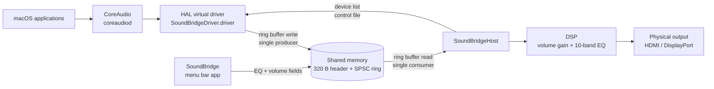

<p align="center">
  
</p>

<p align="center">
  <sub>The menu bar panel, with an LG UltraGear's (SoundBridge) proxy device selected as the output.</sub>
</p>

<h1 align="center">SoundBridge</h1>

<p align="center">
  <b>System-wide volume control and 10-band EQ for HDMI and DisplayPort audio on macOS</b><br>
  <sub>macOS 13 or later · universal build · unsigned: not notarized, no automatic updates</sub>
</p>

<p align="center">
  <a href="https://github.com/chenjy16/SoundBridge/releases">Download</a> ·
  <a href="#install">Install</a> ·
  <a href="#why-soundbridge">Why SoundBridge?</a> ·
  <a href="#features">Features</a> ·
  <a href="#how-it-works">How it works</a> ·
  <a href="#verification">Verification</a> ·
  <a href="#documentation">Documentation</a>
</p>

---

## Introduction

SoundBridge is a macOS menu bar app that gives HDMI and DisplayPort outputs a
working volume control and a 10-band tone stage. The system volume slider, the
volume keys and mute control the display's output level, and the audio is
processed in software before it reaches the physical device.

It is built for outputs that arrive at a fixed volume — the case where macOS
greys out the volume slider and the only remaining control is the monitor's own
buttons or on-screen menu.

There is no kernel extension and no privileged daemon: a virtual CoreAudio HAL
device plus a background Host process owned by your user account.

## Why SoundBridge?

Many monitors receive audio over HDMI or DisplayPort but expose no hardware
volume control. macOS detects that and disables the volume slider for that
output; the keyboard volume keys do nothing. The remaining workaround is to
change the volume inside each app, and some apps offer no volume control at all.

**Unlike MonitorControl, which depends on the display supporting the DDC/CI
protocol, SoundBridge works through a system-level virtual audio device — so it
takes effect even when the TV, an older monitor or a dock has no hardware volume
control at all.**

| | DDC/CI tools (e.g. MonitorControl) | SoundBridge |
|---|---|---|
| Where the volume is applied | In the display, via DDC/CI commands over the video cable | In software, inside the audio path |
| Display must support DDC/CI volume | Yes | No — nothing is asked of the display |
| Outputs that work | Those that answer DDC/CI on the active link | HDMI / DisplayPort outputs macOS enumerates, including audio that arrives through a dock or adapter |
| Tone control | Whatever the display offers | 10-band EQ with Bass / Mids / Treble macros |
| Kernel extension | None | None |

The comparison is about how each tool controls volume. DDC/CI tools do things
SoundBridge does not — brightness, contrast, input switching — and are the better
choice when your display does implement DDC/CI and you want the change made on
the hardware side.

## Features

- **System-wide volume control** for fixed-volume HDMI/DisplayPort outputs. The
  slider and the keyboard volume keys control the level sent to the display.
- **Mute and unmute** from the menu bar and from the system.
- **The menu bar reports what the proxy device accepted, not what was
  requested.** A volume or mute change is written to the proxy and then read
  back; the slider and the toggle follow the value the device reports. A write
  that is accepted and then dropped is logged and never shown as applied. A
  change made while nothing is playing is committed to shared memory and is still
  in effect when playback starts, and it survives a Host restart or a driver
  reconnection without being reset.
- **A 48 dB range with a decibel taper at the device.** The driver exposes 48 raw
  volume steps over 48 dB, so one step is one decibel; gain changes are smoothed
  to avoid clicks.
- **10-band EQ engine** exposed as three macro controls — Bass, Mids, Treble —
  plus a reset. Adjustments are applied inside the audio render callback while
  audio is playing, and the settings are kept per output device: they are
  restored on launch and re-sent to the DSP, so a restart of the app or a
  reconnection of the driver does not flatten them.
- **One proxy device per detected display**, named `<display> (SoundBridge)`, so
  switching outputs between displays keeps working.
- **No default-output hijacking**: SoundBridge becomes the system output only
  when you pick it.
- **Guided onboarding** that points at the official installer package and
  verifies that the installed driver matches this app build.
- **Universal build** (Apple silicon and Intel in one binary).
- **No kernel extension, no privileged daemon.** The driver is a user-space
  AudioServerPlugIn loaded by `coreaudiod`; the Host runs as your user.

Not supported: EQ presets, per-band frequency or Q editing, and spectrum
displays. The EQ is three macro controls over a fixed 10-band layout.

## Installation

### Download

Every release is published on GitHub Releases:

<https://github.com/chenjy16/SoundBridge/releases>

A release carries:

| File | Contents | Use it when |
|---|---|---|
| `SoundBridge-*.pkg` | App **and** HAL driver | First install, or any upgrade. This is the supported path. |
| `SoundBridge-*.dmg` | App only | You only want to replace the app. It never writes to `/Library/Audio/Plug-Ins/HAL/`. |
| `SHA256SUMS.txt` | Checksums of the files above | Verifying the download |
| `INSTALLATION_GUIDE.md`, `RELEASE_NOTES.md` | The release's own installation steps and change list | Reading before you install |

Check a download before installing:

```bash
shasum -a 256 -c SHA256SUMS.txt
```

### Install

1. **Download the PKG** from
   [the latest release](https://github.com/chenjy16/SoundBridge/releases). The
   package carries the app **and** the driver; the DMG carries the app only and
   never writes to `/Library/Audio/Plug-Ins/HAL/`.
2. **Double-click the package** and approve the administrator prompt. Quit
   SoundBridge first if an older copy is running. The driver is replaced as a
   transaction, with a backup and a rollback.
3. **Allow it once.** macOS refuses the first launch of unsigned software —
   *"SoundBridge" cannot be opened because Apple cannot check it for malicious
   software*, or on Apple silicon *"SoundBridge" is damaged and can't be opened*.
   Both mean "unsigned", not "broken". Open **System Settings → Privacy &
   Security**, find SoundBridge in the security section and click **Open Anyway**.
   If macOS blocks the package before Installer appears, allow that the same way.
   See [Unsigned distribution and Gatekeeper](#unsigned-distribution-and-gatekeeper)
   for what this does and does not guarantee.
4. **Open `SoundBridge.app`**, then select **`<your display> (SoundBridge)`** as
   the system output. The slider, the volume keys and mute now control the
   display's output level; the menu bar switches between displays when there is
   more than one.

Nothing here needs Gatekeeper or SIP turned off. If your Mac is managed by an
organisation that forbids unsigned software, this release cannot be installed —
see [Unsigned distribution and Gatekeeper](#unsigned-distribution-and-gatekeeper).

Install the app and the driver from the same release, and upgrade with the PKG
rather than the DMG. The two speak a versioned shared-memory protocol, and a
driver older than the app does not produce audio. The installer checks the
protocol before it replaces anything and refuses a downgrade.

> Step 3 is Apple's documented path for unsigned software. Installs on the
> validation machine were performed with the `installer` command line, so the
> dialog sequence itself is documented here rather than measured — see
> [Verification](#verification). Troubleshooting, uninstall and rollback:
> [docs/INSTALLATION_GUIDE.md](docs/INSTALLATION_GUIDE.md).

### First launch

1. Launch SoundBridge and follow the onboarding.
2. If the driver is missing or does not match this app build, the onboarding
   opens the installer package from the same release. Install it, then choose
   **Check Again**.
3. Select the SoundBridge proxy device in **System Settings → Sound**.
4. Select your physical HDMI or DisplayPort output in the SoundBridge menu bar.
5. Adjust volume, mute and EQ from the menu bar.

### Unsigned distribution and Gatekeeper

SoundBridge is distributed without an Apple Developer ID signature and without
Apple notarization. This is a deliberate, permanent distribution policy, not an
unfinished step, and it is the honest description of what every release is:

- No Developer ID certificate.
- No ad-hoc signature either: there is no explicit `codesign --sign` step
  anywhere in the build or the release workflow.
- No notarization: no `notarytool`, no stapling.
- Gatekeeper therefore **rejects** both the app and the package (`spctl` reports
  `rejected / source=no usable signature`). That is the expected result, not a
  build failure.
- **There is no automatic update, and nothing is waiting to be switched on.**
  Sparkle needs an EdDSA key pair and a published appcast; this project has
  neither. `SUPublicEDKey` is empty, `SUEnableAutomaticChecks` is false, no
  `appcast.xml` is generated or uploaded, and `make sign` and
  `tools/generate_appcast.sh` exist only to refuse (exit 2). The `SUFeedURL` in
  `Info.plist` is not an update channel — the driver-compatibility notice reads
  it to derive a link to the releases page, and no appcast is ever served from
  it. `Sparkle.framework` stays in the bundle because the app links it at
  launch. Upgrades are a downloaded PKG.
- **Do not** disable Gatekeeper or SIP to install SoundBridge. Nothing in this
  project requires it, and release validation was performed with both enabled.
- If your organisation enforces a policy that forbids unsigned software, this
  release cannot be installed at all.

The approval flow is not identical on every macOS version or for both package
types. Apple documents **System Settings → Privacy & Security → Open Anyway** as
the path for unsigned software; the GUI dialog has not been exercised on the
validation machine.

Loading an unsigned HAL driver is **environment-dependent**. macOS has changed
how it treats unsigned plug-ins across releases, and managed or MDM-controlled
machines may refuse them outright. On the validation machine — SIP enabled,
Gatekeeper enabled — the unsigned driver **was** loaded by `coreaudiod`, with the
load confirmed in the system log. That is one machine, and it does not generalise
to every macOS version or every hardware and security configuration.

The only signature material inside the artifacts is what the toolchain and one
dependency add on their own:

- the linker-written ad-hoc CodeDirectory that `ld64` puts into every Mach-O
  (`flags=0x20002(adhoc,linker-signed)`, no certificate, no TeamIdentifier) —
  Apple silicon requires it for the code to load at all;
- the upstream ad-hoc seals that ship inside `Sparkle.framework`, which are
  third-party and are not produced by this project.

Neither is a Developer ID signature, and neither is a statement that Gatekeeper
will accept the software.

## How It Works

SoundBridge uses a virtual audio driver and a separate Host process to control and
process audio before it reaches the physical output device.

### Audio path



### Audio processing flow

1. macOS routes application audio to the SoundBridge virtual output device.
2. The HAL driver receives the audio and writes it into a shared-memory ring
   buffer.
3. The Host process reads the frames from that ring buffer.
4. Volume gain, mute and the optional DSP chain are applied.
5. The result is rendered to the selected physical output device.

The physical output keeps its own format and sample rate, and nothing is
intercepted in the kernel. The menu bar app writes control fields only — volume,
mute and EQ — and never touches the audio frames.

### Components

| Component | Language | Role |
|---|---|---|
| Menu bar app | Swift / SwiftUI | User interface, onboarding, driver detection, EQ and volume state |
| HAL driver | C++ | Proxy AudioServerPlugIn inside `coreaudiod`; format conversion and ring-buffer write |
| Host | Swift | Creates the shared memory, reads the ring buffer, renders to the physical device |
| DSP | C / C++ | Volume gain and 10-band EQ behind a C ABI, used by the Host |

## Requirements

- macOS 13.0 (Ventura) or later. This is the deployment target in the package
  manifests and in the bundle `Info.plist`; it is not a claim that every such
  version has been tested.
- An HDMI or DisplayPort audio output.
- Administrator rights for the one-time driver installation.
- A universal build is produced, but only Apple silicon has been exercised. See
  [Verification](#verification).

Verified platform: macOS 27.2.1 (build 26B131), arm64.

### Hardware considerations

SoundBridge targets outputs whose audio arrives over HDMI or DisplayPort at a
fixed volume. What it can do on a given machine depends on the Mac model and
architecture, the macOS version, the display's firmware and audio
implementation, the connection path (direct cable, dock or adapter), the
negotiated sample rate and buffer size, and any other installed audio driver or
virtual device. Not every HDMI or DisplayPort device has been validated, and two
devices that look identical on paper can behave differently. The configurations
that were measured are listed under [Verification](#verification).

## Verification

SoundBridge is verified at three levels that are kept explicitly separate:
automated suites, physical hardware measurements, and everything that remains
unverified.

### Automated verification

`make test` runs the whole suite. It covers:

- DSP signal processing and numerical correctness, including concurrency and
  live configuration updates.
- The shared-memory protocol: header layout, field offsets, and the single-source
  rule for the four header copies.
- Host audio rendering, callback-lifecycle and device-management behaviour.
- Driver and Host integration across a process boundary.
- Installer transaction, rollback and uninstall behaviour.
- The unsigned release policy: no signing, notarization or appcast can creep back
  into the build, the workflow or `tools/`.

Test counts and the exact commands for a given release are recorded in that
release's report rather than here, because they change with every release.

Package and payload integrity are checked separately, because they need a built
bundle: `make verify-payload` checks the packaged app and driver, and
`make test-release-payload` breaks copies of the artifacts on purpose and asserts
that the verifiers notice.

### Hardware verification

Physical validation, performed on 2026-11-23 with SIP and Gatekeeper enabled, has
exercised:

- Real CoreAudio routing through the SoundBridge proxy device.
- Playback to a physical DisplayPort output at 48 kHz with a 512-frame buffer.
- 30 minutes of continuous playback with callback monitoring: 169,686
  callbacks, none over budget, maximum 322 µs, p99 72–74 µs, no underruns.
- A 4× CPU-load phase in the middle of that window, with no underrun or overrun
  increase.
- Graceful shutdown and resource cleanup: the Host exited with the app, the proxy
  devices disappeared, the mappings and control file were removed, and neither
  `coreaudiod` nor the driver process restarted.

That run carries the harness verdict
**`INCOMPLETE — REQUIRED HARDWARE EVIDENCE MISSING`**. It is quoted that way on
purpose: device-removal recovery and the in-run default-output restore marker
were never exercised, and p99.9 is not observable. It supports "no callback
exceeded its deadline on this device, at this format, under this load" and
nothing more.

### Verification limitations

Software tests and limited hardware tests do not establish a universal real-time
guarantee. The following still need evidence:

- Complete p99.9 callback latency.
- Sample-rate and buffer-size matrices beyond 48 kHz and 512 frames.
- Device removal and re-enumeration while playing.
- Extended-duration and thermally stressed runs.
- Additional hardware, macOS versions and Intel Macs.
- Application-specific audio behaviour and real-world listening tests.

Every measurement quoted here comes from a single machine and a single day. The
reports under [docs/release/](docs/release/) hold the raw record, and
[docs/risks/Known-Limitations.md](docs/risks/Known-Limitations.md) holds the
register of what is still open.

## Known Limitations

- **Coverage is narrow by design of the evidence, not of the product.** Measured:
  one DisplayPort device, 48 kHz, 512-frame buffer, one macOS version, Apple
  silicon. Unmeasured: other formats and buffer sizes, device removal while
  playing, thermal stress, Intel Macs.
- **No universal real-time guarantee.** Callback behaviour under arbitrary system
  load has not been formally bounded.
- **The EQ is three macro controls.** No per-band editing, no presets, no
  spectrum display.
- **Loading an unsigned driver is environment-dependent.** See
  [Unsigned distribution and Gatekeeper](#unsigned-distribution-and-gatekeeper).
- **PKG and DMG packaging is not byte-reproducible**, although the binaries are.
- **The uninstaller keeps the PKG receipt and the installer transaction state**;
  see [Uninstallation](#uninstallation) for what is removed and what is kept.

The project prioritises audio correctness, lifecycle safety and predictable
failure handling over claiming universal compatibility. The full register, with
severity and per-item status, is
[docs/risks/Known-Limitations.md](docs/risks/Known-Limitations.md).

## Uninstallation

Menu bar → **Uninstall Driver**, or `tools/uninstall_driver.sh` (`--dry-run`
prints the plan and changes nothing). Both apply the same policy: read
`CFBundleIdentifier`, refuse anything that is not `com.soundbridge.driver`,
refuse a symlink or a foreign bundle, and then remove exactly one constant path.

The script removes the driver files and reports the other three states as
separate facts: whether the driver was unloaded from `coreaudiod`, whether the
CoreAudio device disappeared, and whether `coreaudiod` was restarted. It does the
removal only, and says so. Before removing anything it stops a Host that belongs
to this installation and releases the runtime IPC files
(`/tmp/soundbridge-<uid>-*` and the device control file).
Running it twice is a no-op, running it with nothing installed says so and exits
0, and a failure exits non-zero and names what it could not do.

Kept on purpose: your EQ and volume settings, the logs, and the app itself. Also
kept, and only reported: the PKG receipt and the installer transaction logs.
`coreaudiod` is never signalled, so the loaded copy stays resident until it is
restarted or the machine reboots.

### After uninstalling

1. Pick your physical output again in **System Settings → Sound**. Nothing
   switches it back for you — the Host does not restore the previous default
   output on the way out.
2. Play something and confirm it reaches the display or the built-in speakers.
3. Restart audio apps that still hold a reference to the removed device.

Do not delete `/tmp/soundbridge-<uid>-*` or the device control file by hand while
a Host is running: the uninstaller releases them itself, and a hand-deleted
mapping only leaves the next launch to rebuild it.

Full steps, troubleshooting and rollback:
[docs/INSTALLATION_GUIDE.md](docs/INSTALLATION_GUIDE.md).

## Architecture and Repository Structure

Shared memory lives at `/tmp/soundbridge-<ownerUID>-<deviceUID>`: a 320-byte
header followed by a single-producer/single-consumer ring buffer of stereo
Float32 frames. The driver is the only producer, the Host is the only consumer,
and the menu bar app writes control fields (volume, mute, EQ). A mapping is
retired and rebuilt when a device disappears and comes back, and the Host's
startup, drain and teardown order is fixed.

The repository is organised into independently maintained components:

```text
SoundBridge/
├── apps/
│   └── mac/
│       └── SoundBridgeApp/     menu bar app (Swift package, SwiftUI)
│
├── packages/
│   ├── driver/                 CoreAudio HAL virtual driver (C++, CMake)
│   ├── dsp/                    DSP engine (C / C++, CMake, ctest suites)
│   ├── host/                   Host process (Swift package with C shims)
│   └── shared/include/         the single source of the shared protocol header
│
├── tools/                      build, packaging, verification, maintenance scripts
├── docs/                       architecture, engineering, development, release, risks
│
├── Makefile
├── VERSION
├── LICENSE
├── THIRD_PARTY_NOTICES.md
└── README.md
```

The driver builds against [libASPL](https://github.com/gavv/libASPL), included as
a git submodule under `packages/driver/vendor/`.

The full design — admission and drain, mapping retirement, quarantine, crash
recovery, real-time constraints and the exact ABI — is in
[docs/architecture/](docs/architecture/) and [docs/engineering/](docs/engineering/).

## Building from Source

### Prerequisites

macOS 13 or later, Xcode command line tools, CMake, Git, and a Swift toolchain
compatible with the project.

```bash
xcode-select --install        # command line tools, if they are not installed
brew install cmake            # if cmake is not already on PATH
```

### Clone and build

```bash
git clone https://github.com/chenjy16/SoundBridge.git
cd SoundBridge
git submodule update --init --recursive
make install-deps
make build          # DSP, driver, host and app; universal
make run            # launch the built app from dist/
```

### Tests

```bash
make test
```

### Common commands

| Command | What it does |
|---|---|
| `make install-deps` | Check that CMake and the Swift toolchain are available |
| `make build` | Protocol check, version sync, then build every component |
| `make bundle` | Assemble `dist/SoundBridge.app` from built components |
| `make run` | Open the existing bundle |
| `make dev` | Reset local state, build, bundle and open (shows onboarding) |
| `make quick` | Rebuild only the Swift components, universal |
| `make test` | Protocol and version checks, then the DSP, driver, host, app, installer and unsigned-policy suites |
| `make protocol-check` | Assert one shared-memory protocol source and identical header copies |
| `make verify-unsigned` | Assert app, PKG and DMG are unsigned and no appcast exists |
| `make rebuild` | Clean rebuild |
| `make clean` | Remove build artifacts |

Refer to the Makefile and [docs/development/DEVELOPMENT_GUIDE.md](docs/development/DEVELOPMENT_GUIDE.md)
for the exact behaviour of each target.

Two rules matter when changing this codebase:

- **The shared-memory header is single-sourced.** Changing a field means bumping
  the protocol version and re-syncing all four copies; `make protocol-check`
  fails otherwise.
- **Nothing in the product may sign, notarize or auto-update.** The unsigned
  assertions are part of the test suite (`make test-unsigned`), and a signing
  command that creeps back into the build or the workflow fails them.

No Apple Developer ID certificate is required for development or release.

## Documentation

| Document | What it answers |
|---|---|
| [docs/README.md](docs/README.md) | Index of engineering documentation, product strategy, and per-release reports |
| [Product roadmap and specification](docs/product/SOUNDBRIDGE-PRODUCT-ROADMAP-AND-SPECIFICATION.md) | Proposed system-wide audio enhancement direction, verified capability baseline, Free/Pro hypotheses, and DSP/calibration/profile roadmap |
| [INSTALLATION_GUIDE.md](docs/INSTALLATION_GUIDE.md) | Install, verify, troubleshoot, uninstall, roll back |
| [RELEASE_NOTES.md](docs/RELEASE_NOTES.md) | What changed in the current release, upgrade and downgrade notes |
| [Architecture](docs/architecture/) | Components, shared memory, ring buffer, admission, retirement, recovery |
| [Engineering notes](docs/engineering/) | Ring buffer contract, CallbackGate memory model, shared-memory lifecycle |
| [DEVELOPMENT_GUIDE.md](docs/development/DEVELOPMENT_GUIDE.md) | Toolchain, build, test, troubleshooting, contribution rules |
| [Known limitations](docs/risks/Known-Limitations.md) | Known defects, known limits, untested areas, environment risks |
| [Hardware realtime runbook](docs/release/SoundBridge-Hardware-Realtime-Operator-Runbook.md) | How the hardware real-time validation is run and recorded |
| [Release reports](docs/release/) | Per-release evidence: hashes, install, driver load, functional and stability results |

## Project Status

SoundBridge is actively developed. It focuses on making fixed-volume HDMI and
DisplayPort audio outputs usable through system-wide software volume control and
equalization.

Development priorities:

- Audio callback safety and predictable performance.
- Driver and Host lifecycle correctness.
- Shared-memory ownership and recovery.
- Hardware compatibility.
- Reliable installation and uninstallation.
- Diagnostics and reproducible verification.

There is no committed roadmap. Open problems, measurements and untested areas are
tracked in one place:
[docs/risks/Known-Limitations.md](docs/risks/Known-Limitations.md). What each
release changes is in its release notes, and what was measured for it is in its
report under [docs/release/](docs/release/).

## Contributing

Bug reports, measurements and technical feedback are welcome. An issue that can
be acted on usually carries:

- the Mac model and architecture (`uname -m`), and the macOS version and build;
- the display or audio device model, and how it is connected — direct cable, dock
  or adapter;
- the SoundBridge version, and which installer you used (PKG or DMG);
- what you expected, what happened instead, and the steps that reproduce it;
- the SoundBridge entries from `os.log`, and for a download problem the output of
  `shasum -a 256 -c SHA256SUMS.txt`.

Changes that touch the driver, the Host, the shared-memory protocol or the DSP
engine need their test results attached and a note on what they do to real-time
behaviour or to a lifecycle. Open an issue before a large architectural change:
the protocol header is single-sourced across four components, so a change there
is a change in all of them.

## License

SoundBridge is **source-available, not open source**. The source, and the
binaries built from it, are licensed under the
[PolyForm Noncommercial License 1.0.0](LICENSE). You may read, run, modify and
share them for any noncommercial purpose: personal use, study, hobby projects,
research, and use by charities, educational institutions, public research
bodies, public safety and health bodies, and government institutions.

Commercial use is not granted by that license. Shipping SoundBridge in a
product, using it in paid work, or selling it requires a separate written
license from the copyright holder.

The license applies to this repository from the commit that added it onward.
Releases published before that commit were published without a license grant; if
you need terms covering one of those versions, contact the copyright holder.

Bundled third-party components keep their own licenses and are not covered by
the PolyForm terms: libASPL is MIT (with Apple's sample-code licenses for the
files it derives from) and Sparkle is MIT. Their notices must be preserved in
redistributions, and the downloads carry them: every bundle ships the license
and [the third-party notices](THIRD_PARTY_NOTICES.md) in
`SoundBridge.app/Contents/Resources/`.

---

<p align="center">
  <sub>SoundBridge — system-wide audio control for HDMI and DisplayPort outputs on macOS.</sub>
</p>
