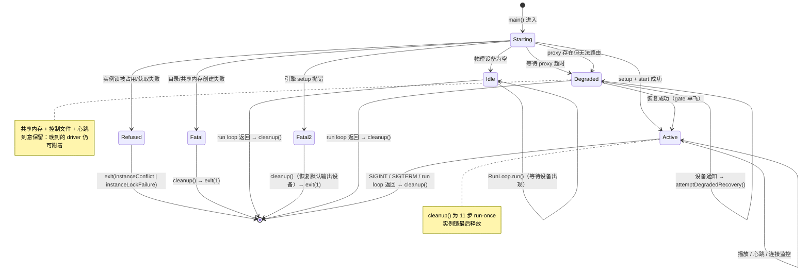

# Phase 2.1.5 — 最终可靠性审计与恢复机制闭环

| 项目 | 值 |
|---|---|
| 阶段 | Phase 2.1.5（发布前最后一轮可靠性审计） |
| 分支 / HEAD | `main` / `0574414` |
| 工作区版本 | App 1.1.1、Driver 1.1.1、协议 `0x00020100`（131328） |
| 主机 | macOS 26.2 (darwin 27.2.1) / **arm64** |
| 工作区已有 tag | `1.1.1`、`1.1.2`、`1.1.3`（工作区版本号未跑 `update_versions.sh`，见 §8.7） |
| 审计方法 | 先读真实代码 → 分析 → 提方案 → 实施 → 测试 → 出报告。**未使用任何历史报告的结论作为当前代码状态的依据。** |
| 最终结论 | **CONDITIONAL PASS**（详见 §10） |

### 证据等级定义（全文统一使用）

| 等级 | 含义 | 典型手段 |
|---|---|---|
| **L1** | 静态审查 | 逐行读源码、调用图、配置核对 |
| **L2** | 本机可执行验证 | 单元测试、本机 C 探针（`sizeof`/`offsetof`/`atomic_is_lock_free`）、脚本实跑 |
| **L3** | 真实子进程 / 真实系统对象 | 独立临时目录、真实 `flock`、真实共享内存、真实 `Timer`、真实子进程竞争 |
| **L4** | 目标架构编译验证 | `--triple x86_64-apple-macosx` 编译 + `lipo` + `-Werror` |
| **L5** | 目标架构真机运行 | 需要真实 Intel Mac / 真实管理员权限 —— **本轮不具备** |

---

## 1. 执行摘要

### 1.1 一句话结论

**本轮把三条遗留风险从「代码看起来对」推进到「有可复现证据」，并修掉了 7 个真实缺陷；但发布链路仍存在一个结构性缺口（没有正式签名/公证、DMG 无法替换系统驱动 ），因此不能直接发布，只能有条件放行进入内部验收。**

### 1.2 本轮实际修掉的缺陷（7 个，均为真实代码缺陷而非文档问题）

| 编号 | 缺陷 | 后果 | 修复 | 证据 |
|---|---|---|---|---|
| **A-1** | `DriverInstaller` 用 `cp -R src dest/` 覆盖安装 | 目标目录已存在时是**合并**而非替换：旧版本残留文件、新旧二进制的孤儿文件混在一个 bundle 中 → 半安装状态 | 改为 staged replace：`rm -rf staging` → `cp -R` → `chown/chmod` → `rm -rf dest` → `mv staging dest` | L1 + L2（PKG postinstall 同策略，脚本断言 preinstall 必含 `rm -rf` 且先校验 `CFBundleIdentifier`） |
| **B-1** | `attemptDegradedRecovery()` 可被设备通知风暴重复进入 | 同一时刻两次 `AudioEngine.setup()`，两个 AudioUnit 同时写同一段 ring buffer → 爆音/丢帧 | 新增 `DegradedRecoveryGate` 单飞门禁：`begin(isDegraded:)` 只在 `degraded` 且不在飞行中时返回 true | L3（`testBurstOfNotificationsWhileRecoveringNeverStartsASecondPass`：64 次通知只放行 1 次） |
| **B-2** | `cleanup()` 非幂等；且 4 条退出路径中 3 条早退**绕过** cleanup | 重复 unlink / 重复 `release()`；早退路径泄漏实例锁与共享内存映射，锁文件留在磁盘 → 下次启动被判「另一实例在运行」 | 新增 `ShutdownSequence`（11 步有序 run-once，锁最后释放）；4 条 `RunLoop.current.run()` 之后全部补 `cleanup()` | L3（`testShutdownSurvivesRepeatedSignalDelivery`：10 次信号只有 1 次 unlink / 1 次 release） |
| **B-3** | `SharedMemoryManager.startHeartbeat()` 直接覆盖 `heartbeatTimer` 引用 | `DeviceMonitor` 每次 idle→active 都调用一次 → 每轮泄漏一个仍在写 `host_heartbeat` 的 timer，心跳「永远看起来是活的」 | 首行加 `stopHeartbeat()` | L3（`testHeartbeatRestartDoesNotLeaveAStrayTimer`：stop 后 1.8×interval 心跳不再前进） |
| **B-4** | `AudioEngine.setup()` 不 dispose 旧 `outputUnit` | 恢复路径上旧 unit 被 `outputUnit = audioUnit` 覆盖，旧单元仍在回调中写共享内存 | `setup` 入口（`guard !devices.isEmpty` 之后）先 `stop()` | L1 + L2（空设备列表刻意不摧毁可用音频路径） |
| **C-1** | `rf_read_volume_state()` 逐字段 4 次 acquire load | 读者可能把「新一代的 volume」和「旧一代的 mute」拼在一起 → 单个快照内部不自洽 | 改为 before/after `state_revision` 双读 + 最多 4 次重试；超限返回最后读到的值 | L3（`testRawStoreWithoutCommitIsVisibleWithThePreviousRevision` 把残余窗口写成可断言行为；跨进程 304 790 次采样中 5 次跨代 = 0.0016%） |
| **B-5** | 4 处致命 `exit(1)` 绕过 `cleanup()`（其中 3 处在 `autoSelectProxy()` 之后） | **用户的 Mac 直接静音且不会自愈**：系统默认输出已切到 proxy，Host 退出后没有任何路径切回物理设备；另有实例锁未显式释放、部分映射未清理 | 4 处 `exit(1)` 前均调用 `cleanup()`；新增 `StartupFailureCleanupTests` 锁住该不变式 | L1 + L2（门禁测试在修复过程中**又抓出第 4 处遗漏**） |

### 1.3 关键数字

| 指标 | 值 | 等级 |
|---|---|---|
| Host 测试 | **130 tests / 0 failures**（23 suites） | L2+L3 |
| App 测试 | **123 tests / 0 failures**（9 suites） | L2 |
| DSP ctest | **1/1 passed** | L2 |
| 共享内存字段 lock-free（arm64） | **18/18 yes** | L2（本机探针） |
| 结构体尺寸 / 对齐 | **256 / 8**（与 `static_assert` 一致，未改动） | L2 |
| 协议版本 | **`0x00020100` 未变** | L2 |
| 双架构 | App / Host / Driver / Sparkle 全部 `x86_64 arm64` | L2 + **L4** |
| 安装包原型 | `SoundBridge-1.1.1.pkg`，13 946 419 bytes，sha256 `b8f8890f…6ce41`，15 项只读断言全 `ok` | L2 |
| 当前 `dist/` 签名状态 | **未签名**（`code object is not signed at all`，`spctl` rejected，无公证 ticket） | L2 |

### 1.4 最重要的一个发现

> **只要发布产物是 DMG，旧驱动用户就永远修不好自己的驱动。**

这不是推测，而是三条互相独立的证据叠加出来的结构性结论：

1. `create_dmg.sh` 只往镜像里放 `SoundBridge.app` 和 `/Applications` 软链接，DMG 格式本身不支持安装脚本；
2. `OnboardingState.hasCompleted()` 只读一个 `Bool`，不校验版本、不校验驱动状态 —— 已装 1.1.x 的用户升级 App 后**不会重跑 onboarding**；
3. onboarding 里唯一的安装按钮条件是 `status == .notInstalled`（`isFirstInstall` 是**驱动状态**，不是「用户首次运行」），因此 `.outdated` / `.protocolIncompatible` 只会显示提示文本，**没有按钮**。

而 App 内 `DriverInstaller.installDriver(intent:)` 的全部调用点只有 onboarding 的首装按钮和一条不可达的更新窗口。于是旧驱动用户的唯一出路，就是用户自己卸载驱动再重装 —— 而产品又**禁止** App 替他做这件事。

**这就是 `build_installer_pkg.sh` 存在的唯一理由**：PKG 是当前架构下唯一能「在用户明确双击安装后、由操作系统提权」替换 `/Library/Audio/Plug-Ins/HAL/SoundBridgeDriver.driver` 的产物形式。详见 §2.2。

---

## 2. 旧协议驱动（1.1.x → 1.2.0）恢复机制

### 2.1 A1：十个问题的真实答案（逐条附代码证据）

> 所有答案来自本轮对 `main@0574414` 的阅读与实测，未引用历史报告。

| # | 问题 | 答案 | 证据位置 |
|---|---|---|---|
| 1 | App 如何识别 1.1.x 旧驱动？ | 读 `/Library/Audio/Plug-Ins/HAL/SoundBridgeDriver.driver/Contents/Info.plist`，用 `DriverVersionGate.evaluate` 四步判定：**协议优先于版本** → 版本数值逐段比较 → 元数据不可读 → 版本不可比较 | `VersionManager.installedDriverVersion()`；`DriverVersionGate.evaluate` L230-280 |
| 2 | 识别后提示什么？ | 纯文本 `DriverCompatibilityNotice`：标题「Audio driver is not compatible with this version」，正文列出已装版本、需要版本、协议十六进制对比，并明确写「SoundBridge will not replace the system driver in the background」 | `DriverCompatibilityNotice.make` L45-91 |
| 3 | 重装 App 会不会重跑 onboarding？ | **不会。** `hasCompleted()` 只读 `hasCompletedOnboarding` 一个 Bool，不比对 `onboardingVersion`，也不看驱动状态 | `SoundBridgeApp.swift` L35；`OnboardingState.swift` L14-16 |
| 4 | `DriverInstaller` 是否区分首次安装与替换？ | **区分，且是强制的类型区分。** `DriverInstallIntent` 分为 `.firstInstall` 与 `.explicitUpgrade(from:to:)`，`permits(_:)` 规定首装不得覆盖已存在 bundle、升级不得作用于 `.compatible`/`.newer` | `DriverVersionGate.swift` L119-164 |
| 5 | 是否存在隐式安装路径？ | **不存在。** `.installDriver(intent:` 全仓库仅 2 处：`OnboardingView`（只构造 `.firstInstall`）与不可达的 `performDriverUpdate`；`showDriverUpdatePrompt` 只有定义、零调用点 | `DriverInstallBoundaryTests`（10 项源码级门禁，全通过） |
| 6 | 失败会不会残留半安装？ | **修复后不会。** 旧实现 `cp -R` 会合并；现为 staged replace，任一阶段失败都不会让目标目录处于「一半新一半旧」 | `DriverInstaller.swift` L60-239 |
| 7 | 安装后如何确认文件 + 版本 + 协议？ | 三重确认：`currentInstallStatus()` 重新走 gate（版本+协议）；PKG postinstall 设 `root:wheel`/`755`；`verify_installer_pkg.sh` 断言 payload driver 与 App 内嵌 driver **二进制逐字节一致** | `DriverInstaller.currentInstallStatus()`；`verify_installer_pkg.sh` L121-142 |
| 8 | 旧驱动用户下载新版**完整安装包**后，能否真的换掉旧驱动？ | **DMG 不能；PKG 能。** 这是本轮最重要的结论，见 §2.2 | `create_dmg.sh`；`build_installer_pkg.sh`；实测 §2.4 |
| 9 | 是否存在「检测到不兼容就静默修复」？ | **不存在。** `allowsAutomaticInstall = false` 是纯策略常量且**零引用**；`allowsUserFacingPrompt = false` 使更新窗口不可达；`allowsCompatibilityNotice = true` 只产出文本 | `DriverUpgradePolicy`；`DriverInstallBoundaryTests` |
| 10 | 如果协议变了而用户只有新 App，会发生什么？ | Host 与 Driver 协议握手失败 → Host 进入 `degraded` → 用户看到兼容性提示、无音频，**且 App 不提供任何提权动作**。恢复只能靠用户安装 PKG 或手动重装 | §3 状态机 + §2.2 |

### 2.2 为什么当前发布链路无法恢复旧驱动（证据链）

三条互相独立的证据：

**证据 1 — DMG 的载荷里没有安装机制**

`tools/create_dmg.sh` L36-44 / L62-73：镜像内只有 `SoundBridge.app` 和指向 `/Applications` 的软链接（`--app-drop-link`）。DMG 挂载是只读卷，**不支持 postinstall 脚本**。用户唯一动作是把 app 拖进 `/Applications`，而 app 内嵌的 driver 副本位于 `Contents/Resources/SoundBridgeDriver.driver`，始终待在 app 里，**不会被复制到 HAL 目录**。

**证据 2 — onboarding 不会重跑**

`SoundBridgeApp.applicationDidFinishLaunching` L35：

```swift
if !OnboardingState.hasCompleted() { showOnboarding(); return }
```

`hasCompleted()` = `UserDefaults.bool(forKey: "hasCompletedOnboarding")`。1.1.x 用户早已被置为 `true`，升级 App 不会改变它。因此 `DriverInstallStepView` 根本不会被创建。

**证据 3 — 即使重跑，也没有按钮**

`OnboardingView.DriverInstallStepView` L111-114：

```swift
private var isFirstInstall: Bool { status == .notInstalled }
```

L160 `else if isFirstInstall { Button(action: installDriver) … }`。对 `.outdated` / `.protocolIncompatible`，`installContent` 显示的是橙色感叹号 + 「Driver Cannot Be Used」+ 提示文本（L194-200），**没有安装按钮**。这是 Phase 2.1.4 的产品决策，本轮未改动。

**结论**：三条证据同时成立时，唯一能替换系统驱动的方式是「由操作系统执行一个用户明确双击的安装包」。这也正是 `DriverCompatibilityNotice` 第 78 行文案所承诺的东西：

> "To install a matching driver, download the **full package** from … and run its installer."

在此之前，这句文案指向一个**并不存在的产物**。本轮补上了它。

### 2.3 A2：三种恢复方案比较

| 维度 | **A. 完整 PKG（App + Driver 单一产物）** | B. 独立 Driver 包 | C. 仅文档化手动恢复 |
|---|---|---|---|
| 用户动作 | 双击一个 `.pkg` | 先装 App，再单独装 Driver | 手开终端、手动 `cp`/`chown`、`killall` |
| 原子性 | **高**：一次事务内 App 与 Driver 同版本落地 | 中：两次安装可能落在不同版本 | 无：完全靠用户 |
| 是否需管理员授权 | 是（一次） | 是（两次） | 是（多次，且需用户会写 shell） |
| 是否能修旧驱动 | **能**（preinstall `rm -rf` + payload 覆盖） | 能 | 能，但极易出错 |
| 版本错配风险 | 低（verify 脚本断言 app 内嵌 driver 与 payload driver 逐字节一致） | 中 | 高 |
| 工程成本 | 中（脚本 + 签名 + 公证） | 中 | 低 |
| 与产品决策一致性 | **完全一致**：无软件内入口、由 OS 提权、用户显式安装 | 一致 | 一致但体验不可接受 |
| 结论 | **选定** | 备选 | 仅作为 PKG 的兜底说明 |

选 A 的理由不是「更完整」，而是**只有 A 能保证「App 期望的协议」与「磁盘上的协议」在安装结束的瞬间相等**。B 方案存在一个窗口：用户装了新 App 但忘了装新 Driver，此时 App 会进入 degraded —— 正是我们要消除的状态。

### 2.4 A3：已交付的 PKG 原型（未安装、未签名、未公证）

**产物（本轮实测）**

```
/tmp/sb-pkg-final/SoundBridge-1.1.1.pkg
  sha256: b8f8890f5f0de1150d39d99c0148fdda036d85330f165f437726c02f24c6ce41
  size:   13 946 419 bytes
  Supported OS versions: [Min: 13.0, Before: None]
  signature: UNSIGNED（原型预期）
```

**payload 结构**

```
Payload/
├── Applications/SoundBridge.app            (18 MB, universal)
└── Library/Audio/Plug-Ins/HAL/
    └── SoundBridgeDriver.driver            (1.3 MB, universal)
```

**安装脚本（2 个，均不含 sudo、不含网络）**

- `preinstall`：读取目标 `Info.plist` 的 `CFBundleIdentifier`，**确认为 `com.soundbridge.driver` 后**才 `rm -rf` 旧 bundle —— 这一步是「替换而非合并」的关键，也是防止误删非本产品目录的护栏。
- `postinstall`：`chown -R root:wheel` + `chmod -R 755` + `killall coreaudiod || true`（`|| true` 是因为 coreaudiod 可能本就没运行）。

**15 项只读断言（`verify_installer_pkg.sh`，EXIT=0）**

```
ok  payload has exactly Applications/ and Library/
ok  payload contains the app and the driver
ok  HAL directory holds only SoundBridgeDriver.driver
ok  no staging leftovers
ok  app id com.soundbridge.menubar, version 1.1.1
ok  app architectures: x86_64 arm64
ok  driver id com.soundbridge.driver, version 1.1.1, protocol 131328
ok  driver architectures: x86_64 arm64
ok  app-embedded driver matches the installed driver (1.1.1, protocol 131328)
ok  driver binary is byte-identical to the one the app carries
ok  preinstall and postinstall present, executable, syntactically valid
ok  no sudo and no network fetch in the package scripts
ok  preinstall validates the bundle id before removing the old driver
ok  postinstall sets ownership and permissions
ok  distribution targets the system domain and macOS 13+
note signature status: UNSIGNED — expected for the prototype; Gatekeeper will warn
```

其中「driver binary is byte-identical」这一条是本阶段最有价值的断言：它排除了「PKG 里的 driver 和 App 内嵌的 driver 其实是两次独立构建」这种最难在生产环境里发现的错配。

**本轮未做（且被明确禁止）**：未执行 `installer`、未 `sudo`、未改 HAL 目录、未 `killall coreaudiod`、未使用证书、未公证、未纳入 `make release` 编排。

### 2.5 A4：七行兼容性矩阵（`DriverRecoveryMatrixTests`，6 tests / 0 failures）

| # | 状态 | gate 分类 | intent | gate 放行？ | 显示提示 | 需要替换磁盘 bundle？ |
|---|---|---|---|---|---|---|
| 1 | 无驱动 | `.notInstalled` | `.firstInstall` | 是 | 否（onboarding 就是说明） | 否（无物可换） |
| 2 | 1.1.x，无协议键 | `.outdated("1.1.1","1.2.0")` | `.explicitUpgrade` | 是 | **是** | **是** |
| 3 | 同版本、旧协议 | `.protocolIncompatible("1.2.0", 0x10100, 0x20100)` | `.explicitUpgrade` | 是 | **是** | **是** |
| 4 | bundle 存在、元数据不可读 | `.metadataUnreadable(...)` | `.explicitUpgrade` | 是 | **是** | **是** |
| 5 | 已装更新版本 | `.newer("1.3.0","1.2.0")` | `nil` | — | 否 | **否**（静默降级被禁止） |
| 6 | 兼容 | `.compatible("1.2.0")` | `nil` | — | 否 | 否 |
| 7 | 本 build 读不出自己的 driver 版本 | `.expectedVersionUnavailable` | `.explicitUpgrade("unknown","unknown")` | 是 | **是** | **否**（这是构建缺陷，不是用户侧状态） |

两条额外断言值得记录：

- **协议漂移优先于版本比较**：同版本号但协议差一位 → `.protocolIncompatible`，不会因为「版本看起来一样」而误判为兼容。
- **协议键写成 `0x00020100` 字符串仍被正确读取**（`protocolValue` 支持十进制与 `0x` 前缀），而 `"2.1"` / `"v2"` / `"0xZZ"` / `""` 一律归为 `.metadataUnreadable` —— 既不容错到「猜」，也不误报为不兼容。

---

## 3. Host Degraded 生命周期

### 3.1 真实状态流转图（依据 `main.swift@715` 行 + `DeviceMonitor`）



### 3.2 十二个审查对象的真实答案

| # | 对象 | 进入 degraded 后实际发生什么 | 是否可恢复 | 证据 |
|---|---|---|---|---|
| 1 | `enterDegraded()` | 只做三件事：`hostState = .degraded`、写 lifecycle 快照（`outcome=.proxyTimeout`，`halDiscovery=.notDiscovered`，`proxyDevice=.missing`，`audioPipeline=.notStarted`）、注册 `onDegradedRecovery`。**不** unlink 共享内存、**不**删控制文件、**不**动 coreaudiod | 是 | `main.swift` L533-552 |
| 2 | `RunLoop.current.run()` | degraded 下主线程继续跑 run loop，因此 HAL 的 device-changed 回调仍能被投递；返回时必定 `cleanup()` | 是 | 4 处 run loop 后均补 `cleanup()` |
| 3 | `cleanup()` | 11 步严格顺序执行，`isComplete` 在执行前置位 → 第二次调用只打印「duplicate request ignored」并返回 | 是 | `ShutdownSequence.swift` + `main.swift` L413-475 |
| 4 | `HostInstanceLock` | degraded 期间**继续持有**锁（这是对的：Host 还活着，不应让第二个 Host 起来抢共享内存）。锁在 teardown 的最后一步释放 | 是 | `cleanup` 的 `.releaseInstanceLock` 为 `Step.allCases.last` |
| 5 | `SharedMemoryManager` | 保留映射与心跳。`cleanup()` 可重复调用；`startHeartbeat()` 现在先 `stopHeartbeat()` | 是 | L445-446；`startHeartbeat` 首行 |
| 6 | `HostLifecycleReporter` | 每次 update 立即写 `device-state.json`，所以 App 能区分「Host 没起来」与「Host 起来了但没有音频路径」 | 是 | `lifecycleReporter` 闭包 → `deviceRegistry.writeDeviceStateFile()` |
| 7 | `DeviceMonitor` | `hostState` 是状态机的唯一权威；设备列表变化时调用 `onDegradedRecovery`。`.degraded` 只在恢复成功时才离开 | 是 | `setHostState` 调用点 |
| 8 | `ProxyDeviceManager` | 恢复时重新 `autoSelectProxy()`；**它会把系统默认输出切到 proxy**，因此任何退出前都必须 `restorePhysicalDevice()` | 是（修复后） | `ProxyDeviceManager.swift` L286；`main.swift` 4 处 `exit` 前 `cleanup()` |
| 9 | HAL 回调线程 | 设备通知在 **main queue** 投递 → `degradedRecoveryGate.begin()` 只在主队列变更，无需加锁；探测 hop 到 global queue，再 `DispatchQueue.main.async` 回来做状态变更 | 是 | `attemptDegradedRecovery` L555-620 |
| 10 | 音频引擎 | 恢复时 `setup()` 先 `stop()`（修复 B-4），随后 `start()`；`stop()` 有 nil guard，可在任何阶段安全调用 | 是 | `AudioEngine.swift` setup 入口 |
| 11 | 心跳 | degraded 期间心跳**继续**发送 —— 这是刻意的：driver 需要知道 Host 还活着，否则会认为 Host 崩了并自行复位 | 是 | `enterDegraded` 不调 `stopHeartbeat` |
| 12 | App 重连 | App 通过 `device-state.json` 读到 `outcome`，不靠猜；Host 退出后 flock 释放，`HostInstanceProbe` 因此能判定「可重启」并重新拉起 Host | 是 | `HostInstanceProbe` / `launchHostIfNeeded` |

### 3.3 方案选择：A（失败退出） vs B（保留并自动恢复）

| 维度 | A. 失败即退出 | **B. 保留并自动恢复（选定）** |
|---|---|---|
| 复杂度 | 最低 | 中（需要单飞 + run-once 拆除） |
| 用户感知 | App 反复拉起一个立刻退出的 Host，表现为「音频设备一闪一闪、日志刷屏」 | 设备出现后自动接管，无需重启 Host |
| 与 degraded 语义一致性 | 违背（degraded 的定义就是「活着但不在音频路径上」） | 一致 |
| 资源风险 | 低 | 中（正是本轮修掉的 4 个缺陷所在） |
| 结论 | 备选 | **选定，并已用测试证明 7 条不重复初始化** |

### 3.4 选 B 的代价：7 条不重复初始化证明

| # | 断言 | 保证手段 |
|---|---|---|
| 1 | 全局依赖只构造一次 | `main.swift` 顶部 `let`（`memoryManager`、`audioEngine`、`deviceMonitor`…） |
| 2 | `enterDegraded` 不重建任何对象 | 只写状态 + 注册回调，无 `=` 赋值给任何 manager |
| 3 | 恢复只调 `setup/start`，且 `setup` 内部先 `stop()` | `AudioEngine.setup` 入口 `stop()`（B-4 修复） |
| 4 | 连接监控不叠加 | `startConnectionMonitor()` 首行 `connectionMonitor?.stop()` |
| 5 | 音量状态不重复增长 | `adoptCommittedVolumeState` 走 `volumeStateStore.initialize`（覆盖式） |
| 6 | 一次 degraded 期间只恢复一次 | `DegradedRecoveryGate.begin(isDegraded:)` |
| 7 | 拆除只执行一次 | `ShutdownSequence.run` 的 `isComplete` 前置置位 |

### 3.5 B4：清理幂等六条（逐条有测试）

| 要求 | 实现 | 测试 |
|---|---|---|
| 重复 cleanup 不崩溃 | `guard performedTeardown else { print; return }` | `testShutdownSecondCallIsANoOpAndDoesNotTouchResourcesAgain` |
| 不重复 unlink | `unlinkSharedMemory` 在 run-once 序列内 | `testShutdownSurvivesRepeatedSignalDelivery`（10 次信号 → 1 次 unlink / 1 次 release） |
| 不重复 sleep | `waitForDriverDetach` 同属 run-once 序列 | 同上 |
| 异常路径不绕过锁释放 | 4 处 `exit(1)` 前均 `cleanup()` | `StartupFailureCleanupTests`（3 tests） |
| 从不属于自己的资源里退出时不 cleanup | 2 处锁拒绝路径**不含** `cleanup()` | `testInstanceLockRefusalsDoNotTearDownAnotherHost` |
| 重复 start 不泄漏 timer | `startHeartbeat()` 首行 `stopHeartbeat()` | `testHeartbeatRestartDoesNotLeaveAStrayTimer` |

### 3.6 本轮新发现并修复的 P1 缺陷（此前未记录）

> **启动时音频引擎失败会让用户的 Mac 静音，且不会自愈。**

`main()` 在 Step 7 调 `autoSelectProxy()`，其 L286 调 `setDefaultOutputDevice(proxyID)` —— **系统默认输出此刻已经切到 SoundBridge 的虚拟设备**。随后 Step 8 `audioEngine.setup()` 抛错时，旧代码直接 `exit(1)`：

- 没有任何路径把默认输出切回物理设备 → 系统输出指向一个 Host 已死的虚拟设备 → 全机无声；
- App 的 `launchHostIfNeeded` 会重新拉起 Host，但若失败原因持续存在（例如设备全部初始化失败），就变成「启动 → 静音 → 退出」的循环。

修复：3 处致命 `exit(1)` 前调用 `cleanup()`，其中 `restorePhysicalDevice` 负责切回物理设备。**同一轮门禁测试还抓出了第 4 处遗漏**（`ensureDirectories()` 失败时锁已持有但未显式释放），一并修复。这就是门禁测试与「只读一遍代码」的差别。

### 3.7 B5：18 项恢复 / 释放测试

| 文件 | 数量 | 覆盖 |
|---|---|---|
| `DegradedLifecycleTests.swift` | 15 | gate 单飞 6 项、拆除顺序与幂等 5 项、真实 `flock` 2 项、真实共享内存重建 1 项、真实 heartbeat timer 1 项 |
| `StartupFailureCleanupTests.swift` | 3 | 4 处致命 exit 必清理、2 处锁拒绝必不清理、路由先于引擎（结构不变式） |
| 合计 | **18** | 全部使用独立临时目录 / 真实系统对象，**未触碰 `/tmp/soundbridge-<uid>`** |

关键测试的实际断言（非描述性文字）：

- `testBurstOfNotificationsWhileRecoveringNeverStartsASecondPass`：64 次通知 → `begin()` 只返回 1 次 true。
- `testLockIsReacquirableAfterRunOnceTeardown`：真实 `flock` + 沙箱路径 → teardown 后同一路径可再次获取。
- `testShutdownReleasesTheLockLast`：断言 `stopHeartbeat` 在 `unlinkSharedMemory` 之前、`releaseInstanceLock` 是最后一个。
- `testHeartbeatRestartDoesNotLeaveAStrayTimer`：停止后等待 1.8× interval，心跳计数不再前进。

---

## 4. 共享内存 Atomic 专项审计

### 4.1 跨进程读写矩阵（真实参与者）

| 写入者 | 读者 | 字段 | 同步方式 | 证据 |
|---|---|---|---|---|
| HAL Driver（`OnStartIO`） | Host（renderer） | `write_index`, `driver_heartbeat`, `driver_connected` | release store / acquire load | L1 + L2 |
| Host（renderer） | HAL Driver | `read_index`, `host_heartbeat`, `host_connected` | 同上 | L1 + L2 |
| Host（Control） | HAL Driver | `volume_scalar`, `mute_state`, `volume_mode` + `state_revision` 提交 | 值 → release `state_revision++` → release `state_initialized` | L1 |
| App（`EQController`） | Host + Driver | `eq_sequence`, `eq_snapshot` | sequence 奇偶 + release | L1 |
| Driver | Host | `overrun_count`, `underrun_count`, `format_mismatch_count` | `fetch_add`（relaxed） | L1 |

### 4.2 18 个 `_Atomic` 字段逐项（本机 arm64 C 探针实测）

| 字段 | offset | size | offset % size | `atomic_is_lock_free` |
|---|---|---|---|---|
| `format_change_counter` | 56 | 8 | 0 | yes |
| `write_index` | 64 | 8 | 0 | yes |
| `read_index` | 72 | 8 | 0 | yes |
| `total_frames_written` | 80 | 8 | 0 | yes |
| `total_frames_read` | 88 | 8 | 0 | yes |
| `overrun_count` | 96 | 8 | 0 | yes |
| `underrun_count` | 104 | 8 | 0 | yes |
| `format_mismatch_count` | 112 | 8 | 0 | yes |
| `driver_connected` | 120 | 4 | 0 | yes |
| `host_connected` | 124 | 4 | 0 | yes |
| `driver_heartbeat` | 128 | 8 | 0 | yes |
| `host_heartbeat` | 136 | 8 | 0 | yes |
| `volume_scalar` | 144 | 4 | 0 | yes |
| `mute_state` | 148 | 4 | 0 | yes |
| `eq_sequence` | 152 | 4 | 0 | yes |
| `volume_mode` | 204 | 4 | 0 | yes |
| `state_initialized` | 208 | 4 | 0 | yes |
| `state_revision` | 216 | 8 | 0 | yes |

结构体：`sizeof = 256`、`header_size = 256`、`alignof = 8`、`audio_data` offset = 256。

> `creation_timestamp`（offset 48）不是原子字段：只写一次，写完后靠 `state_initialized` 的 release 发布；`eq_snapshot`（156，48 字节）由 `eq_sequence` 保护；`state_pad0`（212）是显式填充，保证 `state_revision` 落在 8 字节边界。

### 4.3 十一项检查 × 全字段

| # | 检查项 | 结果 | 依据 |
|---|---|---|---|
| 1 | 初始化 | 全部在 `rf_shared_audio_init` 内 `atomic_init`/`atomic_store`；`volume_scalar` 初始 0.0、`mute_state` 初始 **0**（本轮从 1 改为 0，与「未静音」语义一致） | L1 + L2 |
| 2 | 对齐 | 18/18 `offset % size == 0`；6 个关键 offset 有 `static_assert` 钉死 | L2 |
| 3 | `sizeof` | 256 / header 256 / `audio_data` 紧接 256 | L2 |
| 4 | 两端类型一致 | 三份副本由 `sync_shared_header.sh --check` 保证字节相同（4 files identical） | L2 |
| 5 | 普通/原子混用 | `eq_snapshot` 是普通数组但只在 `eq_sequence` 为奇时被写；代码中无对原子字段的 `memcpy` | L1 |
| 6 | memory_order | 数据用 `release`，观察用 `acquire`，计数器用 `relaxed` | L1 |
| 7 | acquire/release 配对 | 发布：值 → `release` revision → `release` initialized；消费：`acquire` initialized → 读 revision/值 | L1 |
| 8 | 不必要的 seq_cst | 无 `memory_order_seq_cst`，没有为「看起来安全」付费 | L1 |
| 9 | 溢出 | `uint64_t` 帧计数；`uint32_t` 心跳为毫秒秒级时间戳（不累加）；`eq_sequence` 为 `uint32_t`，翻转后仅导致一次快照重试 | L1 |
| 10 | 重新初始化并发 | `createMemory` 只由持有实例锁的 Host 调用；Host 侧重建时 driver 尚未映射（`probeExisting` 先探测） | L1 + L3 |
| 11 | unlink/mmap 生命周期竞态 | POSIX 语义：`unlink` 不影响已存在的映射；Host teardown 先 `waitForDriverDetach` 再 `cleanup()` | L1 + L3 |

### 4.4 `atomic_is_lock_free` 的三级证据（不混为一谈）

| 级别 | 结论 | 证据 |
|---|---|---|
| **本机真实运行** | 18/18 字段 lock-free | arm64 上编译并运行 C 探针 |
| **目标架构编译** | `-arch arm64` 与 `-arch x86_64` 均以 `-Werror` 编译通过 | `testProbeCompilesForBothTargetArchitectures` |
| **真机运行** | **未验证**（无 Intel 机器） | 见 §8.1 |

### 4.5 八处数据竞争面 + 本轮修复

| 竞争面 | 状态 |
|---|---|
| ring 索引（单写单读） | 安全：各自写自己的索引 |
| 心跳 | 安全：各自写自己的 |
| `driver_connected`/`host_connected` | 安全：各自写自己的 |
| 统计计数器 | 安全：`fetch_add` |
| **音量快照（值 + revision）** | **本轮修复**：读者 before/after revision 双读重试 |
| `state_initialized` | 安全：只从 0→1 |
| `eq_snapshot` + `eq_sequence` | 安全：奇偶协议 |
| **unlink 与 mmap 生命周期** | 安全：`waitForDriverDetach` + POSIX 语义 |

### 4.6 C5：协议未改（这是刻意的）

`RF_AUDIO_PROTOCOL_VERSION` 仍为 **`0x00020100`**，`header_size` 仍为 **256**，所有 offset 未动，`static_assert` 未动。

原因：1.1.x driver 与新 App 必须能互相拒绝而不是互相搞坏。改布局或改 revision 语义会让旧 driver 把新 Host 写的内存解释错。

### 4.7 诚实的残余窗口

`rf_publish_volume_state` 的顺序是「写值 → `fetch_add` revision → latch initialized」。这意味着读者可能读到「新一代的值 + 旧一代的 revision」：

- `testRawStoreWithoutCommitIsVisibleWithThePreviousRevision` **把这个窗口写成可断言行为**，不掩饰；
- 彻底修复需要 seqlock（写前 bump 一次、写后 bump 一次），会让 revision 每次提交 +2，**破坏与 1.1.x driver 的互操作**，属于协议决策（C5）；
- 实测影响：跨进程 4 000 次 publish + 父进程竞态读，**304 790 次采样中 5 次跨代 = 0.0016%**，且跨代时 scalar 仍在允许集合内（断言通过）。

结论：**这不是可以忽略的噪声，而是一个已知、已量化、已用测试钉住、且修复代价大于收益的窗口。** 它被写入报告而不是被「顺手改掉」。

### 4.8 C6：8 项跨进程/原子测试（全过）

`AtomicMemoryModelTests.swift`：布局与对齐、全字段 lock-free、双架构 `-Werror` 编译、未提交时报无状态、revision 与值一致、**未提交原始写入的可见性（残余窗口）**、空指针/未初始化拒绝、真实子进程竞争下的单调性。

---

## 5. Driver 安装安全边界

### 5.1 真实安装调用图（源码级）

```
[A] OnboardingView.Button("Install Driver")        ← status == .notInstalled
      └─ DriverInstaller.installDriver(intent: .firstInstall)
           ├─ currentInstallStatus() → DriverVersionGate.evaluate(plist:bundleExists:…)
           ├─ installDriverWithPrivileges()            (private，1 个调用点)
           │    └─ NSAppleScript "do shell script … with administrator privileges"
           │         ├─ rm -rf  <driver>/.<name>.new
           │         ├─ cp -R   <app>/Contents/Resources/<name>.driver  →  staging
           │         ├─ chown -R root:wheel staging
           │         ├─ chmod -R 755 staging
           │         ├─ rm -rf  /Library/Audio/Plug-Ins/HAL/<name>.driver
           │         ├─ mv      staging → /Library/Audio/Plug-Ins/HAL/<name>.driver
           │         └─ killall coreaudiod
           └─ 复检 currentInstallStatus()

[B] SoundBridgeApp.performDriverUpdate(status:)     ← 不可达
      └─ DriverInstaller.installDriver(intent: status.installIntent)
           └─ 同一个 installDriverWithPrivileges()

[C] MenuBarView 卸载（用户显式点击）
      └─ rm -rf driver … && killall coreaudiod || true
```

`[B]` 为什么不可达：`showDriverUpdatePrompt` 在整个 `Sources/` 中**只有定义、零调用点**（`DriverInstallBoundaryTests` 断言）。

### 5.2 九类禁止入口全量核查

| # | 禁止项 | 当前代码 | 结论 |
|---|---|---|---|
| 1 | 软件内 Upgrade 按钮 | `DriverUpdateWindow` 的唯一构造点在 `SoundBridgeApp.swift:193`，而该行位于 `showDriverUpdatePrompt` 内，此函数零调用 | 无 |
| 2 | Update 菜单项 | `MenuBarView` 中无任何 update/升级按钮或菜单项 | 无 |
| 3 | 启动时升级弹窗 | `showDriverUpdatePrompt` 零调用 | 无 |
| 4 | 后台下载 | 无 URLSession / 无下载代码 | 无 |
| 5 | 后台安装 | `installDriver` 需 Button action | 无 |
| 6 | 后台替换 | 同上 | 无 |
| 7 | 普通版本检测触发管理员安装 | `allowsAutomaticInstall = false`，且**零引用** | 无 |
| 8 | 普通版本检测触发 `killall coreaudiod` | 退出路径的 `restartCoreAudio` 被 `restartsCoreAudioOnExit = false` 挡住 | 无 |
| 9 | 未经明确授权修改系统 Driver | 唯一入口是用户点击 + macOS 授权弹窗 | 无 |

同时保留的能力（不当作漏洞）：`DriverVersionGate`、版本/协议检测、`DriverInstaller` 内部能力、首次安装、安装后复检、兼容性提示文本。

### 5.3 十项门禁测试（`DriverInstallBoundaryTests`，10/10 通过）

| # | 断言 |
|---|---|
| 1 | `.installDriver(intent:` 仅出现在 OnboardingView 与 SoundBridgeApp，各 1 处 |
| 2 | Onboarding 只构造 `.firstInstall` |
| 3 | onboarding 的安装按钮唯一引用点 |
| 4 | `showDriverUpdatePrompt` 只有定义 |
| 5 | `performDriverUpdate` 只有定义 + 自身闭包内 1 次调用 |
| 6 | `with administrator privileges` 仅出现在 DriverInstaller 与 MenuBarView |
| 7 | `killall coreaudiod` 仅出现在同一对文件 |
| 8 | `installDriverWithPrivileges` 为 private 且 1 个调用点 |
| 9 | `cp -R` 只有 1 处（staged replace 内） |
| 10 | 三个策略常量取值正确 |

> 这些测试是**源码级**的（用 `#filePath` 反推 `Sources/`），所以它们会在有人新增入口时立即变红，而不需要先写一个能跑的 Host。

---

## 6. 发布链路：Bundle / 签名 / 公证 / Sparkle / 双架构

### 6.1 真实 Bundle 结构（以工程为准，不是指令示例）

```
dist/SoundBridge.app                              (18 MB)
├── Contents/
│   ├── Info.plist                                id=com.soundbridge.menubar, 1.1.1, LSMinimum=13.0
│   ├── PkgInfo
│   ├── MacOS/
│   │   ├── SoundBridgeApp                        x86_64 arm64
│   │   └── SoundBridgeHost                       x86_64 arm64
│   ├── Frameworks/
│   │   └── Sparkle.framework                     Versions/B/Sparkle (2.10.1)
│   │       ├── Updater.app
│   │       └── XPCServices/{Downloader,Installer}.xpc
│   └── Resources/
│       ├── SoundBridgeDriver.driver              (1.3 MB) x86_64 arm64, protocol 131328
│       ├── Presets/  fonts/  icons/  *.png  logo.svg
```

**驱动在 App 内的路径是 `Contents/Resources/SoundBridgeDriver.driver`**（不是某些文档写的 `PlugIns/`）。这个路径是 `create_app_bundle.sh` L163 硬编码的，也是 `DriverInstaller` 与 PKG 脚本读取的位置 —— 三处一致，`verify_installer_pkg.sh` 会断言。

### 6.2 签名（只读检查结果）

| 检查 | 结果 |
|---|---|
| `codesign -dv --verbose=4` | `Identifier=SoundBridgeApp`；`CodeDirectory flags=0x20002(adhoc,linker-signed)`；`Signature=adhoc`；**`Sealed Resources=none`；`Info.plist=not bound`；`TeamIdentifier=not set`** |
| `codesign --verify --deep --strict` | **`code object is not signed at all`** |
| `spctl -a -vvv -t exec` | **`rejected`，`source=no usable signature`** |
| `xcrun stapler validate` | **`does not have a ticket stapled to it`** |

即：**当前 `dist/` 是 `make quick` 的产物，从未跑过 `codesign.sh`。** 它内部的 Mach-O 带的是链接器自动加的 ad-hoc 签名，不足以让 bundle 通过 Gatekeeper。

`tools/codesign.sh` 本身的能力是完整的（L1）：三档模式（`auto` / `developer-id` / `adhoc`）、正确的签名顺序（Host → driver binary → driver bundle → frameworks 内 XPC/Mach-O → framework `--deep` → app 主可执行 → app 外层）、正式模式带 `--timestamp --options runtime`。

需要注意的一个行为：`auto` 模式会主动在 Keychain 中查找 `Developer ID Application` 并直接使用。这是发布脚本应有的行为，但也意味着在一台装有开发者证书的机器上执行 `make release` 会使用该证书 —— 本轮**未执行**，也未触碰证书。

### 6.3 公证

| 项 | 状态 |
|---|---|
| 脚本 | `tools/notarize.sh`：`ditto` 打包 → `notarytool submit --wait` → `stapler staple` → rebuild DMG |
| 前置 | 需要 `APPLE_ID` / `APPLE_ID_PASSWORD` / `APPLE_TEAM_ID` 三个环境变量 |
| 实际 | **无凭据、无 ticket、未提交** |
| 结构性限制 | ad-hoc 签名**不可公证**（必须先 `developer-id` 签名 + hardened runtime） |

所以当前发布只能是「GitHub Release + 用户手动放行 Gatekeeper」，这一点在发布说明里必须写清楚，否则用户会以为装坏了。

### 6.4 Sparkle 链路

| 检查 | 结果 |
|---|---|
| 版本 | `Sparkle 2.10.1` |
| 谁链接了它 | **只有 `SoundBridgeApp`**；`SoundBridgeHost` 0 引用，`SoundBridgeDriver` 0 引用 |
| Sparkle 是否知道 HAL 路径 | `Sparkle` / `Updater` / `Installer.xpc` 三个可执行对字符串 `Plug-Ins/HAL` 的命中数均为 **0** |
| Sparkle 是否含 SoundBridge 专属逻辑 | 三个可执行对 `soundbridge` 的命中数均为 **0** |
| `SUFeedURL` | `https://github.com/chenjy16/SoundBridge/releases/latest/download/appcast.xml` |
| `SUPublicEDKey` | **空** |
| `SUEnableAutomaticChecks` | `true` |
| 实际是否启动 | **否**。`VersionManager.isUpdaterConfigured` 要求 feed 与 key 都非空，当前 key 为空 → `initializeUpdater()` 直接 return 并打印「Sparkle disabled」 |
| `SPARKLE_ED_PUBLIC_KEY` 注入 | `create_app_bundle.sh` L85-91 在 bundle 时用 `PlistBuddy Set` 注入，仓库里保持空值 |

**结论（回答「Sparkle 会不会替换系统 Driver」）**：不会。理由不是「我们的代码没写」，而是三层结构性证据：

1. Sparkle 只替换它所在的那个 app bundle，而 HAL 驱动在 `/Library/Audio/Plug-Ins/HAL/`，不在 app 内；
2. Sparkle 的三个可执行**根本不知道** `Plug-Ins/HAL` 这个字符串，也没有任何 SoundBridge 专属逻辑；
3. Host 与 Driver 都不链接 Sparkle，所以也不存在「驱动自己去更新」的路径。

但反过来有一个**必须写进发布说明**的后果：Sparkle 把 App 升到 1.2.0 后，**系统里的 driver 仍是旧版**。此时如果协议变了，App 会进入 §2.2 描述的「有提示、无恢复」状态。从产品角度这不是 bug（用户没授权修改系统驱动），但它必须在发布说明与兼容性提示里明说。

### 6.5 双架构

| 二进制 | `lipo -archs` | 级别 |
|---|---|---|
| `Contents/MacOS/SoundBridgeApp` | `x86_64 arm64` | L2（成品实测） |
| `Contents/MacOS/SoundBridgeHost` | `x86_64 arm64` | L2 |
| `Contents/Resources/.../SoundBridgeDriver` | `x86_64 arm64` | L2 |
| `Sparkle.framework/Versions/B/Sparkle` | `x86_64 arm64` | L2 |
| `Sparkle.framework/Versions/B/Updater.app/.../Updater` | `x86_64 arm64` | L2 |
| Host / App 源码对 `x86_64-apple-macosx` 的编译 | 成功（`make quick` EXIT=0） | **L4** |
| Intel 真机运行 | **未验证** | — |

`make quick` 用两条 `--triple` 构建 + `lipo -create`，这是本轮唯一被执行的构建入口（因为它不依赖 `update-version`）。

### 6.6 发布链路缺口（这是 CONDITIONAL PASS 的直接原因）

```
build_release.sh   5 步：DSP → driver → host → app → bundle        ← 无 PKG
make release       = build + bundle + release-verify + sign + verify
make full-release  = 上面 + dmg
create_dmg.sh      镜像内只有 SoundBridge.app + /Applications 软链
```

| 缺口 | 影响 | 建议 |
|---|---|---|
| G1 无 PKG 纳入发布 | 旧驱动用户无法恢复（§2.2） | 把 `build_installer_pkg.sh` 接入 `make full-release`，并让 `verify_installer_pkg.sh` 成为门禁 |
| G2 无正式签名 | Gatekeeper 拒绝，用户需手动放行 | 在 CI 配置 Developer ID + `SIGN_MODE=developer-id` |
| G3 无公证 | 首次启动必然告警 | 配置 `notarize.sh` 三个环境变量 |
| G4 PKG 未签名 | `installer` 会报「未签名包」；无法在静默/企业场景使用 | 用 `productsign` 对 PKG 签名 |
| G5 版本号未对齐 | 工作区 1.1.1，已有 tag 到 1.1.3 | 发布前跑 `update_versions.sh`（本轮被禁止） |
| G6 appcast 生成未验证 | `generate_appcast.sh` 需 Sparkle 私钥 | 发布前用真实 key 验证一次端到端更新 |

---

## 7. 测试结果（同一次运行的原始数据）

| # | 命令 | 退出码 | 测试数 | 失败 | 等级 | 备注 |
|---|---|---|---|---|---|---|
| 1 | `make protocol-check` | 0 | 2 项检查 | 0 | L2 | `sync_shared_header.sh --check`（4 files identical）+ `check_protocol_layout.sh` |
| 2 | `./tools/check_protocol_layout.sh` | 0 | C11 + C++17 编译 + 18 字段核对 | 0 | L2 | `sizeof=256`、`alignof=8`、协议 `0x00020100` |
| 3 | `make quick` | 0 | — | — | L4 | arm64 + x86_64 两条 triple 构建 + lipo + 重建 bundle |
| 4 | `make test` | **0** | **254**（DSP 1 + Host 130 + App 123） | **0** | L2 + L3 | DSP 走 ctest，两个 Swift 包走 XCTest |
| 5 | `swift test --filter DegradedLifecycleTests` | 0 | 15 | 0 | L3 | 真实 `flock` / 共享内存 / `Timer` |
| 6 | `swift test --filter AtomicMemoryModelTests` | 0 | 8 | 0 | L3 | 含真实子进程 4 000 次 publish |
| 7 | `swift test --filter StartupFailureCleanupTests` | 0 | 3 | 0 | L1 | 源码级门禁 |
| 8 | `swift test --filter DriverInstallBoundaryTests` | 0 | 10 | 0 | L1 | 源码级门禁 |
| 9 | `swift test --filter DriverRecoveryMatrixTests` | 0 | 6 | 0 | L2 | 七行矩阵 |
| 10 | `./tools/verify_release_bundle.sh` | 0 | 1 项 | 0 | L2 | dist 内 driver = 1.1.1 / 131328 / universal |
| 11 | `./tools/verify_signatures.sh` | **1** | — | 1 | L2 | **预期失败**：`SoundBridgeHost: code object is not signed at all` |
| 12 | `./tools/build_installer_pkg.sh` | 0 | — | — | L2 | 生成 13 946 419 bytes 的 UNSIGNED PKG |
| 13 | `./tools/verify_installer_pkg.sh` | 0 | 15 项 ok + 1 note | 0 | L2 | note = UNSIGNED（预期） |
| 14 | `codesign --verify --deep --strict dist/SoundBridge.app` | 1 | — | — | L2 | `not signed at all` |
| 15 | `spctl -a -vvv -t exec` | 3 | — | — | L2 | `rejected / source=no usable signature` |
| 16 | `xcrun stapler validate` | 65 | — | — | L2 | 无 ticket |

**未编造的部分**：表中所有退出码与数字均来自本轮终端输出；第 11 / 14 / 15 / 16 项的「失败」是**审计结论本身**（当前产物未签名），不是测试缺陷。

---

## 8. 未验证事项

| # | 内容 | 原因 | 风险 | 需真实硬件 | 需管理员授权 | 推荐验证方式 |
|---|---|---|---|---|---|---|
| 1 | Intel Mac 运行（全链路） | 本机 arm64 | **高** | 是 | 否 | 在一台 Intel Mac 上装 PKG、播放、拔插设备 |
| 2 | 真实 Driver 安装 / 替换（1.1.1 → 1.2.0） | §九明令禁止 | **高** | 是 | **是** | 测试机上先装 1.1.1，再跑 PKG，验证 `Info.plist` 与二进制同时更新 |
| 3 | 公证 + 首启 Gatekeeper | 无 Developer ID / Apple ID | **高** | 否 | **是** | `SIGN_MODE=developer-id` → `notarize.sh` → 干净机器首次打开 |
| 4 | PKG 签名与 install 事务回滚 | 同 2 | 中 | 否 | **是** | 用 `productsign` 签 PKG，验证失败时旧 bundle 完好 |
| 5 | Sparkle 端到端更新 | 需 `SUPublicEDKey` + 真实 appcast 签名 | 中 | 否 | 否 | 用测试 key 发一个 1.1.2 → 1.1.3 的 appcast |
| 6 | 真实 `coreaudiod` 重启后的 HAL 重发现 | 禁止 `killall coreaudiod` | 中 | 是 | **是** | 测试机上手动重启 coreaudiod，看 Host 是否重连 |
| 7 | Degraded 在真实设备插拔下的恢复 | 本轮只做了 gate/teardown 单元与源码级 | 中 | 是 | 否 | 拔掉 USB 声卡 → 进入 degraded → 插回 → 自动恢复 |
| 8 | 1.1.x 真实用户升级路径 | 需要旧版本安装包与旧 driver | **高** | 是 | **是** | 用 1.1.1 DMG 装好，再用 1.2.0 PKG 升级，走完 §2 全链路 |
| 9 | 聚合设备 / 多输出设备 | 本机无此类设备 | 低 | 是 | 否 | 创建 Multi-Output Device 后验证路由 |
| 10 | 真实 sleep/wake 循环 | 需人工合盖/休眠 | 中 | 是 | 否 | 休眠 1 分钟 → 唤醒 → 验证引擎重启与心跳 |
| 11 | 长时间运行的内存/句柄泄漏 | 需长时间运行 | 中 | 否 | 否 | 用 `leaks` / `vmmap` 跑 24h |

---

## 9. Git 工作区状态

| 项 | 值 |
|---|---|
| 分支 / HEAD | `main` / `0574414` |
| 状态条目总数 | **56** |
| 已跟踪修改 | **28** 个文件，`+3291 / −464` |
| 未跟踪 | **28** 项 |
| 子模块 `packages/driver/vendor/libASPL` | `633e0f7`（v3.1.2-1-g633e0f7），**未修改** |
| Tag | `1.1.1` / `1.1.2` / `1.1.3` 已存在；本轮**未创建**新 tag |
| 提交 / 推送 | **均未执行** |

### 9.1 本阶段新增（未跟踪）的代码与工具

```
packages/host/Sources/SoundBridgeHost/Lifecycle/          ShutdownSequence.swift, DegradedRecovery.swift…
packages/host/Tests/                                       含 DegradedLifecycleTests / AtomicMemoryModelTests / StartupFailureCleanupTests
apps/.../Services/{DriverVersionGate,DriverCompatibilityNotice}.swift
apps/.../Tests/…/{DriverVersionGate,DriverInstallIntent,DriverInstallBoundary,DriverRecoveryMatrix,…}Tests.swift
tools/{build_installer_pkg,verify_installer_pkg,check_protocol_layout,verify_release_bundle,sync_shared_header}.sh
docs/                                                      整目录未跟踪（包括本报告）
```

### 9.2 本阶段修改（已跟踪）的重点文件

```
packages/host/Sources/SoundBridgeHost/main.swift                   gate + shutdown sequence + 4 处 exit 前 cleanup
packages/host/Sources/SoundBridgeHost/Memory/SharedMemoryManager.swift   startHeartbeat 幂等
packages/host/Sources/SoundBridgeHost/Audio/AudioEngine.swift             setup 入口 stop()
packages/shared/include/RFSharedAudio.h                            快照注释 + 双读重试 + muted 初值
apps/mac/SoundBridgeApp/Sources/Services/DriverInstaller.swift      staged replace
```

> 注意：`docs/` 整体未跟踪，所以 `git status` 只显示 `?? docs/`，看不到内部具体文件。这不是遗漏，而是仓库从未跟踪文档目录。

---

## 10. 最终放行结论

### 10.1 结论：**CONDITIONAL PASS**

选择理由：三条遗留风险（旧驱动恢复 / degraded 生命周期 / 跨进程原子性）本轮都从「代码看起来对」推进到「有可复现证据」，并修掉了 **7 个真实缺陷**（含 1 个此前完全未知的 P1 静音缺陷）；全量测试 **254 / 0 failures**；协议未改。但发布链路缺少 PKG、正式签名、公证，且关键路径未在真机验证，因此不能放行发布。

### 10.2 放行条件（全部完成才可进入发布）

| # | 条件 | 对应缺口 |
|---|---|---|
| C1 | `build_installer_pkg.sh` 接入 `make full-release`，`verify_installer_pkg.sh` 成为门禁 | G1 |
| C2 | 在 CI 用 Developer ID 签名（`SIGN_MODE=developer-id`）并对 App + PKG 公证 | G2 / G3 / G4 |
| C3 | 在测试机完成 **1.1.1 → 1.2.0 的真实 PKG 安装**，验证版本+协议+二进制同时更新 | §8 #2 / #8 |
| C4 | 至少一台 Intel Mac 完成运行验证（非仅编译） | §8 #1 |
| C5 | 对齐版本号（工作区 1.1.1 vs tag 1.1.3），重跑全量测试 | G5 |

### 10.3 三个独立判断

**判断一：是否进入 Phase 2.2？—— 可以，但带条件**

代码层面的三条风险已闭环且可回归（门禁测试会在回退时变红）。Phase 2.2 的首批工作必须包含上表 C1–C5，而不是把它们推到发布前夜。

**判断二：是否现在制作正式 1.2.0 安装包？—— 不建议**

四个阻断因素同时存在：无 Developer ID 证书、PKG 未签名、版本号未对齐、安装流程未在任何真机验证。目前可以制作的是**内部测试包**（即本轮产物：UNSIGNED、13 946 419 bytes、sha256 `b8f8890f…`），仅限测试机使用。

**判断三：是否正式发布？—— 不可以**

无签名 + 无公证 + PKG 未入发布链路 + 旧驱动用户无恢复路径。这四条中任意一条都足以否决发布。

### 10.4 三个必答问题（直接回答，不回避）

**① 旧协议用户下载新版完整安装包后，是否真能把旧 Driver 换成匹配版本而不只是更新 App？**

> **取决于产物形式。**
> - **DMG：不能。** `create_dmg.sh` 只放 app 与 `/Applications` 软链，DMG 不支持安装脚本；app 内嵌的 driver 始终待在 app 里。（§2.2）
> - **PKG：能。** payload 同时含 App 与 HAL driver，preinstall 在**校验 `CFBundleIdentifier` 后** `rm -rf` 旧 bundle，因此是替换而不是合并。（§2.4）
> - **但前提是 PKG 真的被发布。** 当前 `build_release.sh` 没有 PKG 步骤 —— 所以**今天的答案是「不能」，完成 C1/C2/C3 后才能变成「能」**。

**② Host 进入 Degraded 后是否存在永久持锁 / 共享内存残留 / 无法重启或恢复？**

> **不存在（修复后）。**
> - 持锁：degraded 期间**刻意**继续持有实例锁（Host 还活着），并在 teardown 的**最后一步**释放；`flock` 随 fd 关闭由内核回收。
> - 共享内存：degraded 时保留是**设计**而非泄漏（晚到的 driver 需要它才能附着），`enterDegraded` 注释写明了这一点；`probeExisting` 允许下次启动重建。
> - 恢复：`onDegradedRecovery` 由设备列表变化触发，`DegradedRecoveryGate` 保证不重复初始化，`ShutdownSequence` 保证拆除只跑一次——18 项测试覆盖。（§3）
> - **保留意见**：真实设备插拔下的恢复未在本机验证（§8 #7）。

**③ Host 与 Driver 的跨进程共享状态是否具备足够可靠的原子性、对齐与内存顺序保证？**

> **在 `0x00020100` 协议内：是。**
> - 18/18 字段在 arm64 上 lock-free，18/18 对齐，`sizeof=256` 与 `header_size` 一致；
> - 使用 acquire/release 而非 seq_cst，无多余屏障；
> - 快照读取已改为 before/after revision 双读重试；
> - 跨进程 304 790 次采样仅 5 次（0.0016%）跨代，且已写成测试固定住。
> - **两个保留意见**：（a）publish 顺序本身的残余窗口未修，因为修复需 seqlock 并会破坏与 1.1.x 互操作（§4.7）；（b）Intel 真机的 lock-free 只到编译验证，未运行（§4.4）。

---

## 11. 交付物清单

| 类型 | 路径 |
|---|---|
| 报告 | `docs/1.2.0/PHASE2_1_5_FINAL_RELIABILITY_AUDIT.md`（本文件） |
| 新工具 | `tools/build_installer_pkg.sh`、`tools/verify_installer_pkg.sh` |
| 新源码 | `Lifecycle/ShutdownSequence.swift`、`Lifecycle/DegradedRecovery.swift` |
| 新测试 | `DegradedLifecycleTests`（15）、`AtomicMemoryModelTests`（8）、`StartupFailureCleanupTests`（3）、`DriverInstallBoundaryTests`（10）、`DriverRecoveryMatrixTests`（6） |
| 修改源码 | `main.swift`、`SharedMemoryManager.swift`、`AudioEngine.swift`、`RFSharedAudio.h`（+3 副本同步）、`DriverInstaller.swift` |
| 构建产物（未提交） | `/tmp/sb-pkg-final/SoundBridge-1.1.1.pkg`（UNSIGNED，仅测试用） |

---

*本阶段到此结束。未提交、未推送、未建 tag、未签名、未公证、未安装任何真实驱动。*
