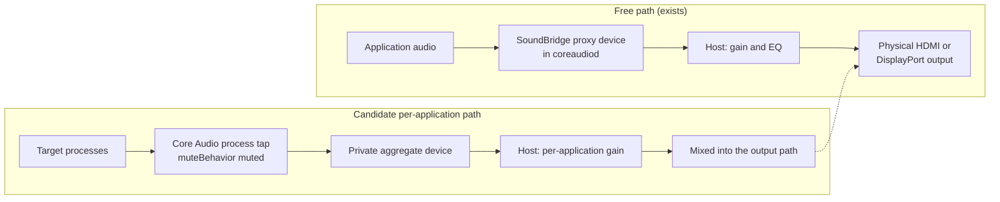

# SoundBridge Product Roadmap

This document describes where SoundBridge is going, in what order, and why. It is
a plan, not a commitment: it contains no release numbers and no dates, because no
release plan has been approved. Items move only when evidence moves.

**How to read it**

| Term | Meaning |
|---|---|
| **Tier** | `Free` (the core product, permanently free), `Paid` (a capability that extends the core), `Research` (an investigation that may produce either) |
| **Status** | `Existing` (shipped and working), `In Progress` (implementation exists but the evidence is incomplete), `Planned` (accepted, not started), `Research` (unknown outcome), `Deferred` (deliberately not now) |
| **Evidence** | `REAL_MACOS_VERIFIED`, `TEST_VERIFIED` (automated suites), `SOURCE_VERIFIED` (the code does what is claimed, nothing has been run), `NOT_VERIFIED` |

The project's evidence rules are the same ones used in
[Known Limitations](../risks/Known-Limitations.md): passing tests never stand in for
hardware evidence, and a single measured configuration is never generalised to
"all Macs".

---

## 1. Vision and Product Direction

SoundBridge makes macOS audio you cannot control controllable.

The product exists because many monitors receive audio over HDMI or DisplayPort
and expose no hardware volume: macOS greys out the volume slider, the volume keys
do nothing, and the only remaining control is inside each application. SoundBridge
inserts a virtual audio device, keeps the familiar system volume and mute
behaviour, and adds a tone stage — without a kernel extension and without a
privileged daemon.

**Long-term direction: reliable system-wide audio control for everyone, with
per-application audio management for users who need more control.**

The free product stays a small, dependable utility. The paid product adds control
that the free product does not have, and never removes control that it already
has. Both remain audio-control software: not a DAW, not a mixing console, not a
driver replacement for every device.

---

## 2. Product Strategy: Free Core + Paid Advanced

| | Free edition | Paid edition |
|---|---|---|
| Role | The product. Complete and usable on its own | An extension for users who need per-application control |
| Receives | Bug fixes, stability work, audio correctness, macOS compatibility, driver maintenance, install/uninstall work, performance, improvements to existing features | Everything the free edition receives, plus the advanced capabilities |
| Never | Gets feature-limited, nagged, or frozen while paid work proceeds | Gets reliability, compatibility, or bug fixes that free users cannot have |

### 2.1 Free edition commitments

1. Every feature that exists today remains free.
2. A paid edition must not degrade, restrict, or complicate the free experience.
3. Maintenance of the free core continues after a paid edition exists; the free
   edition is not a trial and does not expire.
4. Free features are not "unlocked" by paying; the paid edition adds capabilities
   that do not exist in the free product.

### 2.2 Paid edition

The first paid capability is **application-level volume control**: adjusting,
muting and remembering the level of individual applications independently of the
system volume. It is the only paid capability with a defined scope in this
document; everything else in section 4.2 is a candidate, not a promise.

### 2.3 Boundary

| Capability | Tier |
|---|---|
| System-wide software volume control | Free |
| System-wide mute and unmute | Free |
| Menu bar controls and output-device selection | Free |
| Fixed-volume output support (HDMI / DisplayPort proxy device) | Free |
| 10-band EQ engine, the Bass / Mids / Treble controls, and per-device persistence | Free |
| Host lifecycle, recovery, diagnostics, onboarding | Free |
| Installation, uninstallation, driver compatibility checks | Free |
| All bug fixes, stability work and macOS compatibility work | Free |
| Per-application volume control | Paid |
| Per-application mute | Paid |
| Per-application volume profiles and restoration | Paid |
| Further application-specific audio management | Paid, only after evaluation |

The boundary is a rule about *what kind of capability* is paid: control over one
application's audio. It is not a list of screens that can be locked later.

---

## 3. Free Edition Scope

### 3.1 What exists today

| Capability | What is actually implemented | Evidence |
|---|---|---|
| System-wide volume | A virtual HAL device per display, named `<display> (SoundBridge)`; the system slider, the volume keys and mute drive the proxy, and the Host applies gain before the physical output | `SOURCE_VERIFIED`; the 48 dB range with 48 raw steps of 1 dB is defined in the shared audio header; volume mapping was measured on hardware |
| Mute | Same path as volume; the menu bar state follows the value the device reports | `SOURCE_VERIFIED`, `TEST_VERIFIED` |
| Menu bar panel | Device name, output-device list, volume slider, mute toggle, EQ controls | `SOURCE_VERIFIED` |
| Output-device selection | The panel lists physical output devices (proxies are hidden); choosing one makes it the system default, through that device's proxy when a proxy exists. The app does not take over the default output unless the user picks a device | `SOURCE_VERIFIED`; switching was exercised on hardware |
| 10-band EQ | One 10-band engine exposed as three macro controls (Bass, Mids, Treble) plus Reset, applied in the render path while audio plays | `SOURCE_VERIFIED`, `TEST_VERIFIED`; audible confirmation exists from an earlier build |
| Per-device EQ persistence | Settings are stored per output device, restored at launch and re-sent to the DSP after a restart or a driver reconnection | `TEST_VERIFIED` in the working tree |
| Host lifecycle | Supervisor, Host-only restart, reconnect requests, degraded recovery, CoreAudio graph rebuild recovery, ordered shutdown | `TEST_VERIFIED`; a Host restart was executed once on real hardware |
| Onboarding and driver checks | Compares the installed driver with the app build, opens the official installer package, re-checks on request | `SOURCE_VERIFIED`, `TEST_VERIFIED` |
| Installation | A PKG built from the app and the driver, a preinstall gate that refuses downgrades and higher protocols, a transaction with backup and rollback | `TEST_VERIFIED`; the installer CLI path was executed on real hardware |
| Uninstallation | Fixed allow-listed path, symlink refusal, Host stopped first, four-state report; keeps the PKG receipt by design | `TEST_VERIFIED` |
| Diagnostics | `os.log` logging across app, host and driver, a read-only shared-memory probe, a host lifecycle report | `SOURCE_VERIFIED` |
| Build | Universal binary (Apple silicon and Intel slices) | `SOURCE_VERIFIED`; only Apple silicon has been run |

### 3.2 Where the free core is weak

These are not new features. They are the reasons the free product is not yet a
long-term dependable utility, and they outrank everything else in this document.

| Topic | State | Reference |
|---|---|---|
| Volume and mute written while nothing is playing | An accepted write could fail to commit; the app now reads back and the Host commits accepted values early, but the driver's write path is unchanged and the slider and key entry points have not been verified on hardware | OBS-1, `R1.1` |
| EQ persistence | Implemented and tested, but not verified through an app relaunch on hardware | OBS-2, `R1.2` |
| Device removal while playing | Never executed; only the state machine is tested | U-1, K5c, `R1.3` |
| Other sample rates and buffer sizes | Only 48 kHz / 512 frames measured | U-6, `R1.5` |
| Long runs, multiple displays | 31 minutes and one display; no ≥ 8 hour run, no two-display run | U-7, U-8, `R1.5` |
| Other macOS versions, Intel Macs | One macOS version, Apple silicon only | U-3, U-5, `R1.6` |
| Driver-side real-time violations | Locking, logging, allocation and format reconfiguration still reachable from the HAL callback chain | RT-1 … RT-5, `R1.4` |
| Crash and re-attach | Process restart is covered; crash and re-attach of the driver is not | U-11, `R1.8` |
| GUI install path | Only the `installer` CLI path has been executed | G-UI, U-18, `R1.7` |
| Packaging reproducibility | Binaries are reproducible; PKG and DMG are not byte-reproducible | OBS-4, `R1.9` |
| Float64 input | Fails closed; a device offering only Float64 would not work | F-1, `R1.10` |

### 3.3 Not part of the product today

| Item | Reality |
|---|---|
| EQ presets | No preset feature exists. A preset type is declared in the app but nothing creates, saves, lists or applies presets. The README states this. |
| Per-band frequency and Q editing | Not implemented; the EQ is three macros over a fixed band layout. |
| Spectrum display | Not implemented. |
| Automatic updates | Not implemented as policy; no update feed is published and no EdDSA key is configured. |
| Crash reporting or telemetry | Not present. There is no analytics service, no account, and no network call for core functionality. |

Several of these could become free features later (see `R2.5`). None of them is a
paid capability.

---

## 4. Paid Edition Scope

### 4.1 First paid capability: application-level volume control

| User need | What the paid capability would do |
|---|---|
| A browser tab is loud, music is not | Lower one application without touching the system level |
| A call client is louder than everything else | Give one application its own level, or mute it |
| A game and background music compete | Independent levels |
| The same setup is repeated every day | Remember per-application levels and restore them |
| One noisy application | Mute one application without muting the Mac |

Scope of the first release of this capability (Phase 4): enumerate applications
that are producing audio, show them, adjust and mute them individually, keep
system-wide volume working, survive application start, exit and audio-session
changes, and say plainly when an application cannot be controlled.

Out of scope for the first release: routing applications to different physical
devices, effects per application, automation, and any mixer surface beyond one
level and one mute per application.

### 4.2 Candidate later paid capabilities

Saved per-application profiles, profiles applied on launch, rule-based behaviour,
and device-plus-application routing. These are directions, not deliverables, and
each must be re-evaluated against maintenance cost (Phase 6).

### 4.3 The platform floor problem

The free app targets macOS 13. The process-tap API that makes per-application
control practical on macOS is documented by Apple as requiring macOS 14.2 or
later. Therefore:

- the paid capability, if it is built on taps, has a **higher OS floor than the
  free app**;
- the free app must keep working on macOS 13 and must not grow a dependency on the
  paid path;
- a macOS 13 user must still get the complete free product, and the paid
  capability must be absent with an explanation, not broken.

Whether a paid feature that requires a newer macOS than the free product is
acceptable is an open product question (section 11.3). It is not a technical
detail.

---

## 5. Development Phases

Phases are ordered by dependency, not by date. A phase is finished when its exit
criteria are met with evidence, not when its items are coded.

### Phase 1 — Stabilize the free core

**Priority: Critical · Tier: Free**

Make the existing product reliable enough to be the permanent free product.

Covers: callback safety, driver and Host lifecycle, shared-memory ownership and
recovery, routing reliability, volume and mute consistency, DSP correctness and
performance, device discovery and hot-plug, sample-rate and buffer handling,
install and uninstall, macOS compatibility, regression tests, hardware
validation.

**Exit criteria**

- Every P1 item in the known-limitations register is closed with real-machine
  evidence, not only tests.
- The volume and mute entry points (menu bar slider, keyboard keys, system
  slider) are verified while nothing is playing.
- Device removal while playing is executed; no crash, no unbounded growth.
- The format and buffer matrix has been run and recorded.
- `RT-1` … `RT-5` are either fixed or written down as accepted limits with a
  measured consequence.
- A pass rate per commit is recorded, not remembered.

**Not in this phase:** anything paid, and any new free feature that is not a
defect fix.

### Phase 2 — Improve the free user experience

**Priority: High · Tier: Free**

Make the free product easier to understand without making it larger.

Covers: clearer first launch, clearer device selection and status, better volume
and mute feedback, better error messages and recovery guidance, more useful
diagnostics, and — only if it survives Phase 1 — optional EQ presets.

**Exit criteria**

- A new user can install, reach a working volume control, and understand why a
  device is or is not adjustable without reading the repository.
- Every failure the product can detect has a message that says what happened and
  what to do next.

### Phase 3 — Research application-level volume

**Priority: High · Tier: Research**

Decide whether the capability can be built to the same standard as the free core,
and at what cost. This phase produces a recommendation and a go/no-go decision,
not a feature.

**Exit criteria**

- A measured proof of concept exists for at least one application: capture,
  per-application gain, output, and measured latency and CPU cost.
- The supported and unsupported scenarios are written down with evidence.
- The interaction with the existing proxy device is decided, including how to
  avoid tapping SoundBridge's own output.
- A go/no-go decision is recorded, with the reasons.

**Do not let this phase delay Phase 1.** It runs in parallel at low intensity and
is paused whenever Phase 1 needs the same attention.

### Phase 4 — Application-level volume MVP

**Priority: High · Tier: Paid candidate**

Deliver a minimal, reliable prototype. It is not sold in this phase.

Covers: enumeration of applications with active audio, names and icons where
available, per-application level and mute, system-wide volume preserved,
application start/exit switching handled, recovery from routing failure, no
effect on unrelated applications, and a dedicated panel that distinguishes system
level from application level.

**Exit criteria**

- The measured latency, CPU and memory overhead of the per-application path are
  recorded and acceptable next to the free path.
- The failure modes have written behaviour: an application that cannot be
  controlled is reported, not silently ignored.
- The real-time rules in section 9.2 hold for the new path.

### Phase 5 — Paid edition and commercialization

**Priority: Conditional on Phase 3 and Phase 4 evidence**

Turn the capability into a paid edition. Nothing in this phase may weaken the free
edition or the distribution policy.

**Exit criteria**

- A pricing model is chosen after an explicit evaluation: audience, maintenance
  cost across macOS versions, support burden, competitor positioning, willingness
  to pay, and the infrastructure needed for payment and licence checks.
- A published Free/Paid comparison exists that contains no free feature.
- The licence mechanism is evaluated on its own terms and does not require code
  signing, notarization, an update feed, a background daemon, or a permanent
  network connection.
- The paid build is not a different product: it is the same app with the advanced
  capability enabled.

### Phase 6 — Expand advanced audio management

**Priority: Future · Tier: Paid**

Only after the paid MVP is stable. Candidate directions are listed in section
4.2; each is prioritised by demand, feasibility and maintenance cost, and each
can be rejected. This phase is where the product is most likely to lose its
focus, so the default answer is no.

---

## 6. Application-Level Volume Control: Technical Direction

### 6.1 What macOS documents

| Fact | Basis |
|---|---|
| A tap is created from a `CATapDescription` with `AudioHardwareCreateProcessTap`, and destroyed with `AudioHardwareDestroyProcessTap`. | Apple Core Audio documentation |
| A description can target specific processes, a mixdown of them, or everything except a set of processes; it carries a mute behaviour, a device UID, a stream index, and a private flag. | Apple Core Audio documentation |
| A tap is read through a HAL aggregate device created with `AudioHardwareCreateAggregateDevice`, added to the device's tap list, and behaves like an input — a microphone. | Apple's "Capturing system audio with Core Audio taps" sample |
| `CATapMuteBehavior` decides whether the tapped process still plays to hardware: `unmuted`, `muted`, or `mutedWhenTapped`. | Apple Core Audio documentation |
| The app must declare `NSAudioCaptureUsageDescription`, and the system asks the user for system audio recording permission the first time audio is read from an aggregate device that contains a tap. | Apple's sample |
| Apple's sample states macOS 14.2 or later. The `CATapDescription` class is marked available earlier in the API metadata, so availability must be checked per symbol and per behaviour, not assumed from the class. | Apple Core Audio documentation |
| Audio-producing processes are enumerable as HAL objects, with bundle identifiers. | Core Audio HAL process object properties |

### 6.2 What is an assumption

| Assumption | Why it must be measured |
|---|---|
| A tap can capture a process whose audio is currently going through the SoundBridge proxy, and the two conversions do not fight each other | The proxy already converts format on the way in; a tap would add a second conversion point |
| Tap → aggregate device → render adds acceptable latency | No number exists for this project; the free path's callback budget is measured, the tap path is not |
| Per-application gain can be applied in the Host's existing render path without a second audio graph | The Host today owns one render path to one physical device |
| Application restart, output-device change and audio-session changes are recoverable without dropping audio for other applications | Apple documents `isProcessRestoreEnabled`; the behaviour under this product's routing is untested |
| Several simultaneous taps are affordable in CPU and memory | Cost per tap is unmeasured here |
| Sample-rate conversion between tap format and device format is acceptable | The aggregate device performs conversion; the quality and latency cost in this configuration is unmeasured |
| Applications that use exclusive access, protected content, or a non-default device can be identified and reported as unsupported | Not documented as a complete list; must be found by testing |

### 6.3 Options considered

| Option | How it would work | Assessment |
|---|---|---|
| **Core Audio process tap into a private aggregate device** | Tap the target processes, read the aggregate device, apply gain in the Host, render to the physical output | Recommended for the proof of concept: attribution is done by the OS, capture is public API, and per-application gain is possible. Cost: OS floor, permission prompt, one more audio path, and unmeasured latency |
| Tap plus the existing proxy as the destination | The tapped signal is rendered into the proxy device, reusing the current pipeline | Attractive if it works, because it reuses the Host's render path; risk of double conversion and of tapping our own output |
| One proxy device per application | Give each application its own virtual device | Rejected as a general solution: it relies on the user assigning outputs per application, and many applications offer no device choice |
| A HAL plugin that identifies I/O clients by process | Separate gain per client inside the driver | Rejected: a HAL I/O client is not a stable process identity, and reaching for one would require private interfaces |
| System-wide capture, then separate by analysis | Capture everything and split it afterwards | Rejected: audio cannot be attributed to a process after mixing |
| DDC/CI display control | Ask the display to change volume | Irrelevant: no per-application concept, and the displays this product exists for do not implement it |
| Private or undocumented APIs | Various | Rejected: not maintainable, and it would break the product's compatibility story |

### 6.4 How it would sit next to what exists

The important consequence: per-application control is **not** a UI change and not a
single extra gain stage. It adds a second way for audio to reach the Host, and the
product must decide which way each application's audio takes. That decision is the
core of Phase 3.

### 6.5 Real-time rules for the new path

Any per-application processing must satisfy the same rules as the current Host
render path: no unbounded blocking, no allocation, no synchronous logging, no
unbounded locks, no uncontrolled graph reconfiguration, no unnecessary
sample-rate conversion, and no unbounded resource growth. A tap graph that can be
rebuilt while audio is flowing must be rebuilt off the render thread, with the
same gate-and-retire discipline the shared-memory path already uses.

### 6.6 Proof-of-concept plan

1. Enumerate audio-producing processes and map them to applications.
2. Create one private tap for one process with `muteBehavior = muted`.
3. Read it through an aggregate device and render it to a physical output.
4. Apply a gain ramp in the render path using the DSP that already exists.
5. Measure: end-to-end latency, callback deadline headroom, CPU with one to four
   taps, memory, and behaviour when the tapped process restarts or changes output.
6. Repeat with the SoundBridge proxy as the destination instead of the physical
   device.
7. Record supported and unsupported applications and the reasons.

**Acceptance for go:** one tap runs for 30 minutes with generated load, with no
missed deadlines beyond the free path's measured worst case, acceptable added
latency, and stable behaviour across process restart. **Acceptance for no-go:**
any of these cannot be met without weakening the free path — in which case the
capability is dropped or re-scoped, not shipped anyway.

### 6.7 Unsupported scenarios to investigate

Exclusive-access applications, protected audio content, applications that bypass
the system output path, applications with their own sample-rate conversion,
Bluetooth and AirPlay outputs, multi-channel sources, and any application whose
audio is produced by a helper process rather than the visible application.

---

## 7. Feature Prioritization

Each item carries priority, tier, status, the problem it solves and how its
completion is proven. Dependencies and risks are in section 7.4.

### 7.1 Free core (Phase 1)

| ID | Item | Pri | Status | Problem, and what it buys | Acceptance criteria |
|---|---|---|---|---|---|
| R1.1 | Commit volume and mute writes when no audio is playing | Critical | In Progress | A user who moves the slider before playback cannot tell whether it worked. Fixing it makes the primary control trustworthy | On hardware, with nothing playing, a slider move and a key press both change the value the device reports and the shared-memory value, ten times in a row; the driver-side write path is either proven or its remaining failure is documented |
| R1.2 | Verify EQ persistence through a relaunch | Critical | In Progress | Users re-dial the EQ after every restart. Fixing it makes the EQ a real setting | Quit and relaunch with two displays: each device's Bass / Mids / Treble match what was left, and the DSP receives them at start; Host restart does not flatten them |
| R1.3 | Device removal and re-enumeration matrix | High | Planned | Unplugging a display while playing is the most common real-world failure and has never been run | Unplug while playing: no crash, no missed deadline beyond the measured worst case, quarantine count recorded, underrun counted; replug re-enumerates; two displays unplugged in sequence |
| R1.4 | Driver-side real-time violations | High | Planned | Locks, logging, allocation and format reconfiguration on the callback chain are the most direct threat to audio correctness | No mutex acquisition, logging, allocation or reconfiguration reachable from the IO thread in the callback chain, or an accepted-limit entry with a measured consequence |
| R1.5 | Format and buffer matrix, long run | High | Planned | One measured configuration cannot support a compatibility claim | 44.1 / 48 / 96 kHz at 128 / 256 / 512 / 1024 frames recorded with underrun, overrun and callback statistics; one run of at least 8 hours |
| R1.6 | macOS and architecture coverage | High | Planned | The product claims macOS 13 and a universal build, and has run on one version and one architecture | A second macOS version completes install, playback, volume, EQ and uninstall; one Intel Mac completes the same |
| R1.7 | Install paths on real hardware | High | Planned | Only the CLI installer path has been executed, and driver restart recovery is unproven | GUI install through Gatekeeper approval on a clean machine; upgrade from the previous release; `coreaudiod` restart recovered with one IO restart |
| R1.8 | Crash re-attach and environment resilience | Medium | Planned | A crashed Host or a cleaned `/tmp` can leave a user with silence and no explanation | Host killed during playback re-attaches without a manual step; deleting the shared-memory file recovers with a reported state, not a hang |
| R1.9 | Reproducible packaging | Medium | Planned | Release evidence cannot compare packaging layers between builds | Two builds from one commit produce identical binaries and documented, explained differences in PKG and DMG |
| R1.10 | Float64 input | Medium | Planned | A device offering only Float64 would fail closed | Either supported, or detected and reported as unsupported before the user loses audio |

### 7.2 Free experience (Phase 2)

| ID | Item | Pri | Status | Problem, and what it buys | Acceptance criteria |
|---|---|---|---|---|---|
| R2.1 | Onboarding that explains the actual state | High | Planned | Users cannot tell "driver missing" from "driver older than the app" from "no display found" | Each state has its own message and next action; a first-time user reaches working volume without reading documentation |
| R2.2 | Device and host status in the panel | High | Planned | A recovering or degraded Host looks the same as a broken one | Panel shows starting, ready, recovering and degraded, and why a device is not adjustable |
| R2.3 | Volume feedback while idle | High | Planned | Depends on `R1.1`; without it the panel can show a value the device has not accepted | Panel never shows an uncommitted value; a rejected write is visible |
| R2.4 | EQ discoverability | Medium | Planned | Three macro controls do not explain which frequencies they move | Each macro states the bands it drives; Reset is obvious; the fixed band layout is documented in the UI |
| R2.5 | EQ presets (optional, free) | Low | Deferred | Users want a starting point rather than a blank EQ | Only if Phase 1 is complete: a small built-in preset list applied to the existing bands, no per-band editing, no new persistence model. Free, not paid |
| R2.6 | One-shot diagnostics export | Medium | Planned | Support conversations start with "send me your logs" | A single action collects app, host and driver log excerpts, the driver version, the host status and the shared-memory header values into one file |
| R2.7 | Recovery guidance for the unsigned install | Medium | Planned | Gatekeeper friction is the first thing a new user meets | Instructions match what the current macOS actually shows; the document does not promise a smoother path than the product has |

### 7.3 Research and paid candidates

| ID | Item | Pri | Tier | Status | Problem, and what it buys | Acceptance criteria |
|---|---|---|---|---|---|---|
| R3.1 | Per-application tap proof of concept | High | Research | Research | Determines whether the first paid capability is buildable at the free core's standard | Section 6.6 measured and recorded; go/no-go written down |
| R3.2 | Capture/route architecture decision | High | Research | Research | Prevents a second audio path from being bolted on without a design | Written decision on tap destination (proxy or physical), own-output exclusion, and graph rebuild discipline |
| R3.3 | Unsupported-scenario register | Medium | Research | Research | Protects against promising universal control | Each scenario in section 6.7 tested or explicitly marked untested |
| R4.1 | Enumerate applications with audio | High | Paid | Planned | The panel needs a truthful list | Applications appear and disappear with their audio; a control that cannot work is not shown as working |
| R4.2 | Per-application level and mute | High | Paid | Planned | The actual capability | Gain and mute per application, system volume unaffected, measured against the free path |
| R4.3 | Application lifecycle handling | High | Paid | Planned | Applications start, exit and switch output constantly | Start, exit, crash and output change do not disturb other applications; recovery is reported |
| R4.4 | Application panel | Medium | Paid | Planned | Users must be able to tell system and application level apart | One panel, one row per application, system level always visible, obvious unsupported state |
| R5.1 | Pricing and licence model evaluation | Conditional | Paid | Research | A paid edition needs a model that survives unsigned distribution | Written evaluation covering the factors in Phase 5; a licence mechanism that works offline or degrades gracefully |
| R6.1 | Profiles, rules, routing | Low | Paid | Deferred | Possible later value | Re-evaluated only after Phase 5 |

### 7.4 Dependencies and risks

| ID | Depends on | Main risk | Evidence to collect |
|---|---|---|---|
| R1.1 | — | The driver write path may be the real cause; the current fix addresses the app and the Host only | Driver-side commit/discard counters; three entry points on hardware |
| R1.2 | — | Per-device keys may collapse to a global key with several displays | Two-display relaunch, values compared before and after |
| R1.3 | R1.1 | A removal may block in a callback that the state machine never models | Removal run with quarantine, underrun and deadline data |
| R1.4 | — | Changing the vendored HAL path may destabilise a working driver | Callback-chain audit plus a stability run |
| R1.5 | R1.4 | Other formats may expose deadline problems hidden at 48 kHz / 512 | Full matrix, recorded per cell |
| R1.6 | R1.3, R1.5 | A second macOS version may change device behaviour, not just APIs | Completed run matrix per version |
| R1.7 | — | Gatekeeper behaviour differs by macOS version, and MDM machines may refuse unsigned software entirely | Screen-level record of the approval flow |
| R2.3 | R1.1 | Reporting a rejection may look like a regression to users | Message wording tested with users |
| R3.1 | — | Taps may not see audio that the proxy owns | Measured capture with the proxy as the output |
| R4.1 | R3.1 | Helper-process audio may be attributed to the wrong application | Per-application attribution list |
| R4.2 | R3.2, R3.1 | A second audio path may double-convert and audibly degrade | Blind listening plus measured null and latency |
| R5.1 | R3.1 | Licence checks may require infrastructure the distribution policy forbids | Written evaluation; no build changes until decided |

### 7.5 Ordering rules

1. Unresolved critical defects in the free core come before any paid work.
2. Evidence beats intent: an item is not "done" because the code exists.
3. Work is sequenced by dependency, never by a calendar.
4. A new free feature that is not a fix does not displace Phase 1 work.
5. Research that produces no decision is not progress.

---

## 8. Success Metrics

No baseline exists for most of these, and no targets are invented. "TBD" means the
metric is defined and the measurement method is defined, but nothing has been
recorded yet.

### 8.1 Free core

| Metric | Baseline | How it is measured | Target |
|---|---|---|---|
| Crash-free sessions | TBD — no crash reporting exists | Local session start/end records in `os.log`, plus an opt-in report if one is ever added; no silent telemetry | TBD |
| Volume and mute commit rate with nothing playing | TBD — three failures were observed before the current fix | Repeat the three-entry-point procedure; a write counts as committed when the device reports it | 100% over ten consecutive attempts |
| Device reconnection success | TBD — never executed | Unplug/replug run per `R1.3` | TBD |
| Regression pass rate per commit | Not recorded per commit | Record the result of the existing suites for every commit that changes app, host, driver or DSP | 100%, recorded |
| Callback deadline misses | One measured point: 48 kHz, 512 frames, one display, 30 minutes with CPU load — zero over-budget callbacks, worst case 322 µs | `os.log` timing snapshots (p50, p95, p99, max) and the shared-memory counters | No regression against the recorded point; the matrix in `R1.5` fills the gaps |
| Supported configurations | One device, one format, one macOS version, Apple silicon | The matrix in `R1.5` and `R1.6` | TBD |
| Critical defect resolution time | TBD | Time from registration in the known-limitations register to a closed entry with evidence | TBD |
| Install success on a clean machine | CLI path only | `R1.7` | TBD |

### 8.2 Paid advanced features

| Metric | Baseline | How it is measured | Target |
|---|---|---|---|
| Application enumeration success rate | TBD | Share of audio-producing processes that map to a named application in the test set | TBD |
| Per-application control success rate | TBD | Share of enumerated applications whose level and mute take effect, verified by measurement not by UI state | TBD |
| Recovery after application switching | TBD | Start, exit, crash and output-change scenarios in `R4.3` | TBD |
| Added latency | TBD | Tap-to-output latency compared with the free path on the same machine | TBD |
| CPU and memory overhead | TBD | Process CPU and footprint with one to four taps, idle and playing | TBD |
| Supported application coverage | TBD | The register from `R3.3` | TBD |
| Adoption, conversion, retention, support burden | TBD | Only if a paid edition exists, and only from data the product actually has; no telemetry exists today | TBD |

### 8.3 Measurement gaps

- `p99.9` is not observable: the timing snapshot exposes p50, p95, p99 and max.
  Either the snapshot is extended or the metric is dropped; do not report it now.
- The shared-memory counters do not distinguish idle from playing time, so
  underrun rates cannot yet be normalised.
- There is no telemetry, so "crash-free sessions" and "conversion" are unmeasurable
  without either user-provided reports or a decision to add local, opt-in
  measurement. That decision is not made here.

---

## 9. Technical Constraints and Risks

### 9.1 Architecture constraints

The product is a menu bar app, a HAL virtual driver inside `coreaudiod`, a separate
Host process, a shared-memory protocol with a fixed header, a single-producer ring
buffer, and a DSP behind a C ABI. Four copies of the shared header are kept in
sync by a tool; the protocol version is checked in the build.

Any per-application work must fit this shape or explicitly change it in writing.
The shared-memory contract, the gate-and-retire discipline, and the "no callback
does unbounded work" rule are not negotiable for the paid path either.

### 9.2 Real-time requirements

New audio processing must not introduce unbounded blocking, allocation,
synchronous logging, unbounded locks, uncontrolled graph reconfiguration,
unnecessary sample-rate conversion, or unbounded growth in the real-time path.
Acceptance for any new audio feature includes measured latency, deadline headroom,
and resource growth — not only functional correctness.

### 9.3 Distribution policy

The project distributes unsigned, non-notarized software with no automatic
updates. Nothing in this roadmap depends on Developer ID signing, notarization,
`notarytool`, a Sparkle feed, EdDSA update keys, or any update mechanism, and no
paid feature may make them prerequisites.

Consequences that shape the plan:

- A paid edition inherits the same Gatekeeper friction as the free edition, and
  this cannot be fixed by buying a certificate inside the scope of this roadmap.
- Licence validation must be evaluated as its own problem: it may not add a
  privileged helper, a permanent background daemon, an update channel, or a
  requirement to be online. Offline operation or graceful degradation is the
  starting assumption to test, not a settled design.
- The absence of updates means users obtain new versions by downloading a package.
  Any paid model must be honest about that.

### 9.4 Risk register

| Risk | Impact | Mitigation |
|---|---|---|
| The volume commit problem is deeper than the app and the Host | The primary control is unreliable in edge cases | Driver-side instrumentation before declaring `R1.1` closed |
| Taps cannot see audio owned by the proxy | The paid capability needs a different architecture | Test both destinations in Phase 3 before committing |
| A second audio path audibly degrades quality | The paid feature makes the product worse | Blind listening plus measured latency and level; the free path stays untouched |
| macOS 14.2 floor fragments the audience | Paid value unavailable to macOS 13 users | Decide explicitly; never break the free app on 13 |
| Driver real-time debt becomes a stability ceiling | Audio glitches under load | `R1.4` outranks all paid work |
| Unsigned distribution blocks organisational users | Smaller audience, more support | Documented, not solved; do not pretend otherwise |
| Maintenance cost of a second audio path across macOS versions | Long-term drag on a small project | Phase 3 must include a maintenance estimate, not only a prototype |
| Scope creep toward a mixer | Loss of the product's focus | Section 12 is binding; Phase 6 defaults to no |

---

## 10. Product Principles

1. **The free product is the product.** It is complete, maintained and never
   degraded to sell something else.
2. **Evidence over claims.** Hardware evidence, or a written statement that none
   exists.
3. **Small and dependable beats large and fragile.** A feature that threatens
   audio correctness is not shipped.
4. **The system's own controls stay the controls.** Volume, mute and the output
   device remain where users already expect them.
5. **Failure is explained.** Every state the product can detect has a message and
   a next step.
6. **Respect the user's machine.** No privileged helper, no kernel extension, no
   silent network access, no background process beyond the Host.
7. **Paid means more control, not less freedom.** No advertising, no artificial
   limits, no nagging.
8. **Say no early.** The cost of a feature is its maintenance, not its first
   commit.

---

## 11. Current Status and Next Priorities

### 11.1 What is true today

- The free product installs, routes audio through a virtual device, controls
  volume and mute, and applies a 10-band EQ through three macro controls with
  per-device persistence.
- One real-hardware run exists: one display, 48 kHz, 512 frames, 30 minutes with
  CPU load, zero over-budget callbacks. Its own verdict is **incomplete** — the
  Host and device recovery checks were not executed — so it supports exactly one
  statement: no missed deadlines for that device, that format, that load.
- Two P1 items (idle volume commit, EQ persistence) have implementations and tests
  in the working tree, and neither has been verified through the user-facing
  entry points on hardware.
- Driver-side real-time violations remain open, and the driver's control write
  path has not changed.
- No paid capability exists. No payment, licensing or update infrastructure
  exists, by policy.
- The documentation is honest about its gaps; that is the project's main
  competitive advantage over claiming more than it can prove.

### 11.2 The next five things, in order

1. `R1.1` — prove or disprove the volume commit fix with the three real entry
   points, and instrument the driver's write path.
2. `R1.2` — confirm EQ persistence through a relaunch with two displays.
3. `R1.3` — run the removal matrix; it is the largest untested risk in normal use.
4. `R1.5` — fill the format and buffer matrix, and run one long session.
5. `R1.4` — remove or accept, in writing, the driver-side real-time violations.

Phase 3 research starts only as capacity allows and pauses whenever the list above
needs attention.

### 11.3 Open questions

| Question | Why it is unresolved | Owner |
|---|---|---|
| Is a paid capability with a higher macOS floor than the free app acceptable? | It splits the audience at the moment of monetisation | Product |
| Which paid model fits unsigned, no-update distribution? | Every option has a support or friction cost that has not been measured | Product |
| Can licence checks work offline without adding infrastructure? | Not evaluated; must not introduce a daemon or a network dependency | Engineering |
| Does per-application control belong on top of the proxy or beside it? | Depends on Phase 3 measurements | Engineering |
| Should EQ presets be free? | They are new functionality, not a paid capability; if added they must be free | Product |
| How much maintenance can this project carry across macOS releases? | Not estimated; the honest answer limits paid scope | Product |

---

## 12. What SoundBridge Will Not Become

- Not a general-purpose digital audio workstation.
- Not a complicated professional audio mixer.
- Not a replacement for every audio driver.
- Not a universal solution for every audio device.
- Not a product that paywalls functionality that already exists.
- Not a product that trades core stability for feature expansion.
- Not a product that needs unnecessary background services or complex
  infrastructure to work.
- Not a product that requires an account, a subscription check or a network
  connection to control the volume.
- Not a product whose paid edition is the only one that receives fixes.

The long-term strategy stays:

**Free users get a reliable SoundBridge. Paid users get more control over their
audio.**

Protect the free core first. Build advanced capabilities only when they can be
delivered without compromising the reliability, simplicity and maintainability of
what already exists.
