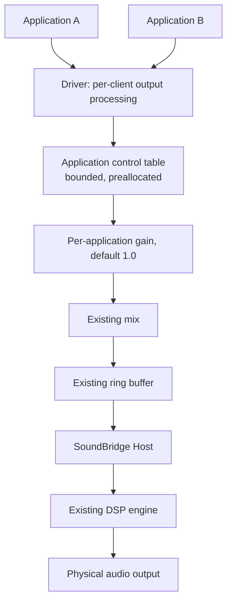

# SoundBridge — Product Roadmap and Product Specification

This document is the product plan for SoundBridge: what the product is, what is
free forever, what the paid edition adds, which architecture is being pursued for
it, and in what order the work happens. It is a plan, not a commitment: it carries
no release numbers and no dates, because no release plan has been approved.

**How to read it**

| Term | Meaning |
|---|---|
| **Tier** | `Free` (the permanent core product), `Paid` (a capability that extends the core), `Research` (an investigation that may produce either) |
| **Status** | `Existing` (implemented and working), `In Progress` (implementation exists, evidence incomplete), `Planned` (accepted, not started), `Research` (unknown outcome), `Deferred` (deliberately not now) |
| **Evidence** | `REAL_MACOS_VERIFIED`, `TEST_VERIFIED` (automated suites), `SOURCE_VERIFIED` (the code does what is claimed and nothing has been run), `NOT_VERIFIED` |

Evidence rules are the ones the project already uses in
[Known Limitations](../risks/Known-Limitations.md): a passing suite never stands in
for hardware evidence, and one measured configuration is never generalised to "all
Macs".

---

## 1. Product Vision

### 1.1 Vision

SoundBridge makes macOS audio that you cannot control controllable.

The product exists because many monitors receive audio over HDMI or DisplayPort
and expose no hardware volume: macOS greys out the volume slider, the volume keys
do nothing, and the only remaining control is inside each application. SoundBridge
inserts a virtual Core Audio device, keeps the familiar system volume, mute and
output selection, and adds a tone stage — with no kernel extension and no
privileged daemon.

The long-term vision is precise control over how audio behaves across the Mac,
without unnecessary complexity and without putting the core audio path at risk.

### 1.2 Product Positioning

**SoundBridge — simple, system-wide audio control for macOS.**

Two complementary layers:

- **Free Core** — a complete, reliable system-wide audio control product that
  stays free and continuously maintained.
- **Paid Advanced** — application-level audio control that adds value beyond what
  the free product does.

The paid edition extends the free product. It does not replace it and does not
restrict anything existing users already have.

### 1.3 Product Principles

1. **The Free Core remains complete.** Existing core functionality stays free,
   including every bug fix, stability fix and compatibility update.
2. **Stability before expansion.** Reliability, compatibility and audio
   correctness outrank new features, in the free product and in the paid one.
3. **Paid features must add value.** A paid capability introduces genuinely new
   functionality, never an artificial restriction of the free product.
4. **Incremental architecture evolution.** Extend the existing audio path where
   practical; avoid premature large-scale audio architecture changes.
5. **Technical feasibility before commitment.** An advanced feature becomes a
   committed capability only after it has passed validation with evidence.
6. **A simple user experience.** SoundBridge stays accessible to ordinary macOS
   users and does not become a professional audio workstation.
7. **Long-term maintainability.** Every capability must justify its ongoing
   engineering and compatibility cost across macOS releases.

---

## 2. Product Structure

| Product layer | Positioning | Primary value |
|---|---|---|
| Free Core | Permanent core product | Reliable system-wide audio control |
| Paid Advanced | Premium audio management | Independent control over individual applications |
| Future Expansion | Advanced audio capabilities | Application-specific processing, routing and automation |

### 2.1 Free Core

The free edition is the foundation. It must remain independently useful and keep
receiving maintenance regardless of what happens to paid development. Existing
core functionality is not moved behind a paywall.

### 2.2 Paid Advanced

The paid edition introduces capabilities that extend the system-wide experience.
The first major paid capability is **application-level volume control**: adjusting
and muting individual applications without changing the system-wide level.

### 2.3 Future Expansion

Later stages may extend application-level control into per-application EQ, output
routing and automated audio profiles. Each remains subject to feasibility, demand
and maintenance-cost evaluation, and none is a commitment.

---

## 3. Free Core — Product Specification

### 3.1 Product objective

Give macOS users a reliable, complete system-wide audio control experience,
especially on external displays whose HDMI or DisplayPort audio arrives at a fixed
volume.

### 3.2 Functional scope

The scope is the functionality that actually exists. Where a capability is
partial, the table says so.

| Feature | Specification | Status today |
|---|---|---|
| System volume | System-wide software volume for fixed-volume outputs, through a per-display proxy device named `<display> (SoundBridge)`; 48 dB range in 1 dB steps | `SOURCE_VERIFIED`; mapping measured on hardware |
| System mute | Mute and unmute through the same path; the menu bar follows the value the device reports | `SOURCE_VERIFIED`, `TEST_VERIFIED` |
| Menu bar controls | Device header, output list, volume slider, mute toggle, EQ controls | `SOURCE_VERIFIED` |
| Keyboard volume keys | The system keys drive the active output device, which is the proxy when it is selected | `SOURCE_VERIFIED`; the key entry point has not been recorded separately (see gap G1) |
| Output device management | The panel lists physical output devices and makes the chosen one the system default, through its proxy when a proxy exists; the app never takes the default output on its own | `SOURCE_VERIFIED`; exercised on hardware |
| Audio routing | Audio is routed through the virtual device, converted, and passed through a single-producer ring buffer to the Host | `SOURCE_VERIFIED`; one measured configuration |
| Global equalizer | A 10-band engine exposed as three macro controls (Bass, Mids, Treble) plus Reset, applied in the render path while audio plays, persisted per output device | `SOURCE_VERIFIED`, `TEST_VERIFIED`; audible confirmation from an earlier build |
| EQ presets | **Not implemented.** A preset type is declared in the app and nothing creates, saves, lists or applies presets; the README states the limitation | `SOURCE_VERIFIED` |
| Device discovery | HAL device-list listener; one proxy per detected display | `SOURCE_VERIFIED`; hot-plug not tested (gap G3) |
| Diagnostics | `os.log` logging across app, host and driver, a read-only shared-memory probe, a host lifecycle report | `SOURCE_VERIFIED` |

If presets are ever added they are part of the Free Core. The row is here because
the implementation, not the intent, defines the feature list.

### 3.3 Maintenance commitment

The Free Core continues to receive: bug fixes and regression prevention; driver
and Host reliability work; DSP correctness and performance work; macOS
compatibility updates; supported-hardware compatibility work; device lifecycle and
recovery work; installation and uninstallation work; security and stability
maintenance.

Core maintenance never depends on buying the paid edition.

### 3.4 Quality objectives

In priority order: correct audio output; predictable volume and mute behaviour;
safe driver and Host lifecycle; real-time callback safety; reliable device
switching and reconnection; stable operation under normal load; reproducible
automated and hardware validation. A new feature that compromises any of these is
not shipped.

### 3.5 Where the free core actually stands

This is the current gap list, taken from the known-limitations register rather
than assembled from impressions. It is the input to Phase 1.

| ID | Gap | State | Reference |
|---|---|---|---|
| G1 | Volume or mute written while nothing is playing may not commit; the app now reads back and the Host commits accepted values early, but the driver write path is unchanged and the slider and key entry points are unverified on hardware | `In Progress` | OBS-1 |
| G2 | EQ persistence is implemented and tested but not verified through an app relaunch on hardware | `In Progress` | OBS-2 |
| G3 | Device removal while playing has never been executed; only the state machine is tested | `Planned` | U-1, K5c |
| G4 | Only 48 kHz at 512 frames has been measured; other rates, buffer sizes and a long run are missing | `Planned` | U-6, U-7 |
| G5 | One macOS version and Apple silicon only; the deployment target claims macOS 13 and the build is universal | `Planned` | U-3, U-5 |
| G6 | Only the installer CLI path has been executed, not the GUI Gatekeeper path, and driver restart recovery is unproven | `Planned` | U-18, G-UI, L-6 |
| G7 | Driver-side real-time violations remain in the callback chain | `Planned` | RT-1 … RT-5 |
| G8 | Crash and re-attach of the driver is not covered; a cleaned `/tmp` is not covered | `Planned` | U-11, U-12 |
| G9 | PKG and DMG are not byte-reproducible, although the binaries are | `Deferred` | OBS-4 |
| G10 | Float64 input fails closed | `Deferred` | F-1 |
| G11 | Very little is measured: one hardware run, whose own verdict is incomplete, and no telemetry of any kind | `Existing` | Section 9.3 |

---

## 4. Paid Advanced — Product Specification

### 4.1 Product objective

Extend SoundBridge from system-wide control to independent application-level
volume management. Different applications need different levels, macOS offers no
universal per-application mixer, and SoundBridge will provide one interface for
the applications it can support.

### 4.2 Initial paid feature: application-level volume control

The user can: see which applications are producing audio; identify them by name
and icon where available; adjust each supported application's level
independently; mute and unmute one application; keep system-wide volume separate;
save per-application preferences and restore them when the application comes back;
and survive application launch, termination and audio-session or device changes.

### 4.3 User experience requirements

One panel, immediately understandable: an application list with name, icon and
current audio activity; one slider and one mute control per row; a clear
unsupported or unavailable state; and a master system level that stays visibly
separate. It is not a professional mixer and does not try to look like one.

### 4.4 Functional boundaries

The initial paid feature is limited to per-application volume and mute. Not in the
initial MVP: per-application EQ, per-application physical output device, complex
multi-channel routing, effect chains, and professional mixing features. Those are
future candidates (section 7.2), each requiring its own feasibility work.

### 4.5 Platform and distribution consequences

- The preferred architecture (section 5) runs inside the existing virtual device
  and keeps the **macOS 13** floor of the free product. This is one of its
  advantages: no user of the free product loses anything, and the paid capability
  does not require a newer macOS than the app.
- The alternative capture architecture (section 7.2) is documented by Apple as
  requiring macOS 14.2 or later and a system-audio recording permission. Choosing
  it later would split the audience by OS version; that cost is the reason it is
  not the first option.
- The project distributes unsigned, non-notarized software with no automatic
  updates. A paid edition inherits exactly that friction. Licence validation is
  evaluated as its own problem (section 10.3) and may not add a privileged helper,
  a permanent daemon, an update channel or a permanent network requirement.

---

## 5. Technical Architecture Evolution

### 5.1 Existing architecture

| Component | Role |
|---|---|
| Menu bar app (Swift / SwiftUI) | Interface, onboarding, driver checks, volume and EQ state |
| HAL driver (C++ over a vendored libASPL) | Proxy AudioServerPlugIn inside `coreaudiod`; format conversion and ring-buffer write |
| Host (Swift) | Owns the shared memory, reads the ring buffer, renders to the physical device |
| DSP (C / C++) | Gain, 10-band EQ, limiter and DC blocker behind a C ABI |

Transport: one shared-memory mapping per device with a fixed header and a
single-producer, single-consumer ring; a callback gate with admission counting and
retirement; four copies of the protocol header kept in sync by a tool.

This architecture remains the foundation of both the Free Core and the initial
paid capability. The paid feature is additive, not a new audio product.

### 5.2 Paid MVP architecture — Driver ProcessOutput plus a shared control table

The preferred initial strategy applies per-application gain **inside the driver,
to each client's output**, before the audio is mixed into the existing shared path.
The transport, the Host and the DSP do not change.

The per-application UI, process enumeration and icon loading stay in the app and
in the Host. Only the table lookup and a gain multiply happen on the audio thread.

### 5.3 Architecture objectives

Preserve the ring buffer, the Host output path and the DSP; avoid one transport
pipeline per application; avoid unnecessary driver and Host restructuring; keep
application management out of real-time callbacks; default to gain 1.0 for any
application without a setting; and guarantee that disabling the paid feature — or
the table being unavailable, or an application being unidentifiable — leaves
existing free behaviour unchanged.

### 5.4 Technical validation requirements

The preferred approach must be validated against the **actual vendored libASPL
commit and the current driver**, not against the name of a callback. What the
pinned code shows today, and what is still unknown:

| Question | What the pinned code shows | What still has to be proven |
|---|---|---|
| Does the callback expose individual client output streams? | Yes, but only in one mode: with `DeviceParameters::EnableMixing = false` the device invokes `OnProcessClientOutput(client, stream, …)` and `OnWriteClientOutput(…)` repeatedly, once per client. The driver currently sets `EnableMixing = true` and only receives the mixed result in `OnWriteMixedOutput` | That the HAL really delivers one call per client per cycle for this plugin, and how partial or silent clients appear |
| Does the callback occur before mixing? | Yes by construction in that mode: the hook receives one client's buffer and the handler becomes responsible for mixing | How the HAL schedules per-client calls relative to the cycle, and whether one client can be late |
| Can audio be modified safely there? | The buffer is a mutable, canonical, interleaved Float32 buffer sized `frameCount × channelCount` | In-place safety in this driver, and where format conversion should then live, because today conversion happens in the mixed callback |
| Can a client be mapped to an application? | `aspl::Client` carries `ClientID`, `ProcessID` (`pid_t`) and `BundleID` | Behaviour for helper processes, and how reliable `BundleID` is for the applications that matter |
| Are multiple clients per application handled? | libASPL documents that an application usually has at most one client, but this is explicitly not a requirement | Aggregation rules when one application owns several clients, and per-client gain consistency |
| Does the callback stay real-time safe? | The hook runs on the real-time thread, and the existing gate, lease and retirement discipline is built around the mixed callback | That the same discipline can wrap N per-client calls per cycle while the driver performs the mixing itself, within the measured deadline budget |
| Does it work with several applications at once? | Not run | The whole matrix: two, three and four applications playing, muting, starting and stopping |
| Are termination and PID reuse safe? | Client lifetime is visible to the driver, which can allocate and release per-client state | Generation-aware identity, because a `pid_t` can be reused, and behaviour on abrupt termination |

Two consequences of what the code shows:

1. `kAudioServerPlugInIOOperationProcessOutput` is not handled by this libASPL
   version; the per-client hook is reached through the mix-output operation. The
   name "ProcessOutput" in this document is a design name, not a callback that
   exists today.
2. Adopting the approach **replaces** the existing mixed-output implementation —
   format detection and conversion, the shared-memory heartbeat, the gate and the
   mapping write all live in `OnWriteMixedOutput` today — and makes the driver
   responsible for mixing every client: the default `OnWriteClientOutput` body is
   empty, so the mixing has to be written. It is not a small addition to the
   existing callback; it is a rewrite of where conversion happens and who mixes.
   Phase 3 exists to decide whether that rewrite preserves the discipline that
   makes the current path trustworthy.

### 5.5 Application control table

The table must be usable from the real-time path:

- preallocated storage, fixed maximum number of entries, bounded lookup;
- no dynamic allocation, no blocking mutex, no synchronous logging in the callback;
- safe publication of updates (the app writes, the audio thread reads);
- staleness handling and generation-aware identity so a reused PID cannot inherit
  another application's gain;
- gain 1.0 for missing, invalid or retired entries;
- predictable behaviour when the table is absent or unreadable: full passthrough,
  never silence.

Enumeration, process metadata, icons and lifecycle management stay outside the
callback, in the app and in the Host's control plane.

### 5.6 Preserving the existing audio path

The existing path must keep working when: the user is on the Free Core; the paid
feature is disabled; no per-application setting exists; the table is unavailable;
an application cannot be identified; or the paid UI is not running.

A failure of the application-level mechanism must not interrupt system-wide audio.
This is a testable requirement, and Phase 4 cannot close without it.

---

## 6. Product Development Roadmap

Phases are ordered by dependency, not by release number. A phase is complete when
its completion criteria are met with evidence, not when its code exists.

### Phase 1 — Free Core stabilization

**Tier:** Free · **Priority:** Critical

**Objective:** a foundation that can be maintained for years.

Scope: driver and Host lifecycle issues; shared-memory ownership and recovery;
callback safety; volume and mute consistency (G1, G2); device discovery and
hot-plug (G3); sample-rate and buffer transitions (G4); DSP correctness and
regression coverage; installation and uninstallation (G6); macOS and hardware
coverage (G5); documented supported configurations.

**Completion criteria**

- Critical defects are resolved or explicitly documented with their consequence.
- Core functionality passes regression testing, and the pass rate is recorded per
  commit instead of remembered.
- Supported configurations have reproducible hardware evidence; the format and
  buffer matrix has been run.
- The volume and mute entry points are verified while nothing is playing.
- Driver-side real-time violations are fixed or accepted in writing with a
  measured consequence.
- No known critical defect is deferred in order to accelerate paid development.

**Not in this phase:** paid work, and any new free feature that is not a fix.

### Phase 2 — Free Core UX and compatibility

**Tier:** Free · **Priority:** High

**Objective:** make the existing product easier to understand without making it
larger.

Scope: first-launch experience; output-device selection and status feedback;
volume and mute interaction; EQ usability; error messages and troubleshooting;
diagnostics and recovery guidance; supported macOS and hardware compatibility.

**Completion criteria**

- A new user can install, reach working volume, and understand why a device is or
  is not adjustable without reading the repository.
- Every failure the product can detect has a message and a next step.
- Compatibility regressions are covered by tests, and user-facing behaviour is
  documented.
- Optional EQ presets are considered here, and only if Phase 1 is complete. If
  added, they are free.

### Phase 3 — Application-level volume feasibility

**Tier:** Paid Research · **Priority:** High

**Objective:** prove that independent application volume can be implemented
without replacing the audio architecture, or establish that it cannot.

Scope: inspect libASPL's per-client output behaviour; verify client identity;
verify pre-mix processing opportunities; prototype per-client gain and mute;
evaluate the shared control table; evaluate callback timing and cost; test several
concurrent applications; test application termination and restart; test PID reuse;
test interaction with the global volume and EQ; measure the conversion question
raised in section 5.4.

**Completion criteria**

- A working multi-application proof of concept exists.
- One application's level changes do not affect any other application.
- Default gain preserves existing behaviour, and disabling the feature is
  byte-for-byte the free path.
- No critical real-time violation is introduced; the per-client callback is
  measured against the same deadline budget as the free path.
- Application lifecycle behaviour is understood, including PID reuse.
- Limitations are documented, and a go/no-go decision is recorded with reasons.

A successful feasibility review is required before MVP development starts. A
no-go is a legitimate outcome and is cheaper than a shipped regression.

### Phase 4 — Paid application volume MVP

**Tier:** Paid · **Priority:** High

**Objective:** a usable, reliable application-level volume and mute feature.

Scope: application enumeration; the application list UI; per-application sliders
and mute; persistent preferences; launch and termination handling; unsupported
application feedback; recovery and error handling; integration with the existing
menu bar experience.

**Completion criteria**

- Supported applications are independently controllable.
- Several applications play at once without interfering with each other's control.
- System-wide volume and the global EQ keep working, including with the feature
  disabled and with the table unavailable.
- Application restarts do not leave stale control assignments.
- No audio routing regression.
- Performance and reliability acceptance criteria are met, measured, not asserted.

### Phase 5 — Paid edition commercialization

**Tier:** Paid · **Priority:** Conditional on Phase 3 and Phase 4 evidence

**Objective:** introduce the paid edition once the capability is stable.

Scope: Free/Paid feature comparison; one-time purchase versus subscription;
pricing hypotheses; payment and licence-validation requirements; purchase and
activation experience; support and maintenance responsibilities; launch
documentation.

**Completion criteria**

- A pricing model is chosen after an explicit evaluation of audience,
  maintenance cost across macOS versions, support burden, competitor positioning,
  willingness to pay, and the infrastructure each model needs.
- The published Free/Paid comparison contains no feature that is free today.
- Licence validation works offline or degrades gracefully, and adds no daemon, no
  update channel and no permanent network dependency.
- The paid build is the same app with the capability enabled, not a second product.

### Phase 6 — Advanced application audio management

**Tier:** Paid Advanced / Research · **Priority:** Future

Scope: per-application EQ; per-application output device; application-specific
routing; saved application audio profiles; automatic volume profiles;
launch-triggered behaviour; advanced session management.

Each candidate needs its own feasibility assessment and can be rejected. Only
after the paid MVP is stable. This is where the product is most likely to lose its
focus, so the default answer is no.

---

## 7. Future Architecture Direction

| Architecture | Capability | Complexity | Position |
|---|---|---|---|
| Driver per-client output plus shared control table | Independent application volume and mute | Low to medium | Preferred for the paid MVP |
| Host-side Core Audio process tap | Per-application capture, processing and routing | Medium | Future option |
| Driver multi-ring-buffer | Independent multi-stream transport | High | Deferred |

### 7.1 Preferred initial approach

Driver per-client output processing with a shared application control table. It is
preferred because it keeps the existing transport, Host and DSP, and applies gain
where the audio already passes. Its feasibility must be demonstrated first
(section 5.4); the fact that it looks smaller is not evidence that it is.

### 7.2 Future advanced architecture

Core Audio process taps are the documented way to capture one process's audio and
would support per-application EQ, processing and routing. What is documented, and
what this project would still have to measure:

| Fact | Basis |
|---|---|
| A tap is created from a `CATapDescription` with `AudioHardwareCreateProcessTap`; a description can target processes, carry a mute behaviour, a device UID and a private flag | Apple Core Audio documentation |
| A tap is read through a HAL aggregate device and behaves like an input | Apple sample code |
| Apple's sample requires macOS 14.2 or later and `NSAudioCaptureUsageDescription`, and the system asks for system-audio recording permission on first read | Apple sample code |
| Round-trip latency, cost per tap, the interaction with this product's proxy device, and behaviour for helper processes, exclusive access and protected content | Unverified here; would need its own proof of concept |

Choosing this path later means a second audio graph, a permission prompt, and a
macOS floor above the free product's. That is why it is a second option, not the
first.

### 7.3 Deferred architecture

Splitting the driver output into several independent ring buffers is not on the
roadmap. It multiplies shared-memory complexity, stream lifecycle, synchronisation,
driver-and-Host coordination, resource management and recovery paths. Reconsider
only if a demonstrated product requirement cannot be met by the preferred
architecture or by a validated tap approach.

---

## 8. Free and Paid Feature Matrix

| Capability | Free Core | Paid Advanced | Future |
|---|:---:|:---:|:---:|
| System-wide volume | Yes | Yes | Yes |
| System-wide mute | Yes | Yes | Yes |
| Global 10-band EQ | Yes | Yes | Yes |
| EQ presets | Not implemented — would be Free if added | Same | Same |
| Output device management | Yes | Yes | Yes |
| Core audio routing | Yes | Yes | Yes |
| Driver and Host maintenance | Yes | Yes | Yes |
| macOS compatibility updates | Yes | Yes | Yes |
| Application-level volume | — | Yes | Yes |
| Application-level mute | — | Yes | Yes |
| Application volume preferences | — | Yes | Yes |
| Application-level EQ | — | — | Under evaluation |
| Application-specific output routing | — | — | Under evaluation |
| Automated audio profiles | — | — | Under evaluation |

The Free Core remains a complete product and keeps receiving essential
maintenance. No row in this table moves from Paid back into Free by removing it
from Free first.

---

## 9. Quality and Success Metrics

### 9.1 Free Core

| Metric | Baseline | How it is measured | Target |
|---|---|---|---|
| Crash-free sessions | TBD — no crash reporting exists | Local session records in `os.log`; an opt-in report only if one is ever added, never silent telemetry | TBD |
| Volume and mute commit rate while idle | TBD — failures were observed before the current fix | The three entry points (panel slider, keyboard keys, system path), a write counts when the device reports it | 100% over ten consecutive attempts |
| Audio routing success rate | TBD | Install → play → switch device → uninstall, recorded per run | TBD |
| Device reconnection success rate | TBD — never executed | The removal matrix (G3) | TBD |
| Callback deadline misses | One measured point: 48 kHz, 512 frames, one display, 30 minutes with CPU load — zero over-budget callbacks, worst case 322 µs | Timing snapshots (p50, p95, p99, max) and the shared-memory counters | No regression against the recorded point; the matrix fills the rest |
| Regression pass rate | Not recorded per commit | The existing suites, recorded for every commit that touches app, host, driver or DSP | 100%, recorded |
| Supported macOS coverage | One version | The matrix in Phase 1 | TBD |
| Critical defect resolution time | TBD | Time from registration in the limitations register to closure with evidence | TBD |
| Hardware validation coverage | 1 device, 1 format | The matrix in Phase 1 | TBD |

### 9.2 Paid Advanced

| Metric | Baseline | How it is measured | Target |
|---|---|---|---|
| Application enumeration success rate | TBD | Share of audio-producing processes that map to a named application in the test set | TBD |
| Per-application volume success rate | TBD | Share of enumerated applications whose level change takes effect, verified by measurement rather than by UI state | TBD |
| Per-application mute success rate | TBD | Same method, mute path | TBD |
| Application restart recovery rate | TBD | Start, exit, crash and output-change scenarios | TBD |
| Added latency | TBD | The per-client callback and the total path measured against the free path on the same machine | TBD |
| CPU and memory overhead | TBD | With one to four applications, idle and playing | TBD |
| Supported application coverage | TBD | The register produced in Phase 3 | TBD |
| Adoption, conversion, support burden | TBD | Only from data the product actually has; no telemetry exists today | TBD |

### 9.3 Measurement gaps

- `p99.9` is not observable: the snapshot exposes p50, p95, p99 and max. Either
  extend it or drop the metric; do not report it now.
- The shared-memory counters do not distinguish idle from playing time, so
  underrun rates cannot yet be normalised.
- There is no telemetry and no account system, so "adoption", "conversion" and
  "crash-free sessions" are unmeasurable without either user-supplied reports or
  a decision to add local, opt-in measurement. That decision is not made here.
- Exactly one hardware real-time run exists, and its own verdict is **incomplete**
  (the Host and device recovery checks were not executed). It supports one
  statement: no missed deadlines for that device, that format and that load.

---

## 10. Product and Engineering Constraints

### 10.1 Real-time audio safety

No unbounded blocking, unnecessary allocation, synchronous logging, unbounded
locks, uncontrolled graph reconfiguration, unnecessary sample-rate conversion or
unbounded resource growth in a real-time path. New audio functionality must carry
measured latency, deadline headroom and resource growth, not only functional
correctness.

### 10.2 Backward behaviour preservation

Paid functionality must not change free behaviour when it is disabled, when no
setting exists, when the control table is unavailable, or when an application
cannot be identified. The default application gain is 1.0. This is a testable
property of Phase 4, not an aspiration.

### 10.3 Distribution policy

The project distributes unsigned, non-notarized software with no automatic
updates. Nothing here depends on Apple Developer ID signing, notarization,
`notarytool`, a Sparkle feed, EdDSA update keys or automatic application updates,
and no paid feature may make them prerequisites.

Payment and licensing are evaluated independently. Consequences that shape the
plan: the paid edition inherits the same Gatekeeper friction as the free edition;
users obtain new versions by downloading a package; and any licence check must be
evaluated against offline operation or graceful degradation rather than assumed to
need a server.

### 10.4 Product scope

SoundBridge is not intended to become: a professional digital audio workstation; a
complicated multi-channel audio mixer; a universal replacement for every audio
driver; or a general-purpose audio production platform. It stays focused on
practical macOS audio control.

---

## 11. Current Product Direction and Next Priorities

### 11.1 Order of work

1. Protect and stabilize the Free Core.
2. Improve the existing user experience and compatibility.
3. Validate the driver per-client output approach.
4. Build a minimal application-level volume and mute proof of concept.
5. Develop the paid MVP after technical validation.
6. Evaluate commercialization after the MVP is stable.
7. Research advanced application-level EQ and routing only when justified.

The first paid capability stays deliberately narrow. Ideas for later stages never
displace a Phase 1 gap.

### 11.2 The next five items

| ID | Item | Why now | Done when |
|---|---|---|---|
| P1.1 | Prove or disprove the idle volume commit fix (G1) | The primary control must be trustworthy before anything is added on top of it | Three entry points verified on hardware, ten consecutive attempts, driver write path instrumented or the remaining failure documented |
| P1.2 | Verify EQ persistence through a relaunch (G2) | Same reason, and it is the only other P1 item | Two displays, values and DSP state identical after relaunch and after a Host restart |
| P1.3 | Run the device removal matrix (G3) | The most common real-world failure has never been executed | Unplug while playing: no crash, quarantine and underrun recorded, replug re-enumerates |
| P1.4 | Fill the format and buffer matrix, plus one long session (G4) | Compatibility claims need more than one cell | Rates and buffer sizes recorded, one run of at least 8 hours |
| P1.5 | Remove or accept the driver-side real-time violations (G7) | They are the direct threat to audio correctness | No lock, log, allocation or reconfiguration reachable from the IO thread, or an accepted limit with a measured consequence |

Phase 3 starts only as capacity allows, and pauses whenever the list above needs
attention.

### 11.3 Open questions

| Question | Why it is unresolved |
|---|---|
| Does the per-client output mode preserve the gate, retirement and conversion discipline of the current mixed path? | It replaces the callback that owns them; only a prototype can answer this |
| Can one application with several clients be identified and controlled consistently? | libASPL gives per-client identity, not per-application grouping |
| How should helper-process audio be attributed? | Bundle and PID are available; attribution rules are a product decision |
| Which paid model fits unsigned, no-update distribution? | Every option has a friction or support cost that has not been measured |
| Can licence checks work offline without new infrastructure? | Not evaluated |
| Should EQ presets be added, and are they free? | New functionality, not a paid capability; if added they must be free |

---

## 12. Product Commitment

**Free users get a reliable SoundBridge. Paid users get more control over their
audio.**

The Free Core remains useful, maintained and independently valuable. The Paid
Advanced edition adds capabilities that extend the product without restricting
what already exists. SoundBridge evolves incrementally, with technical validation
and product value deciding each stage.

Reliability comes first. Advanced control comes next. Architectural complexity is
introduced only when the product genuinely needs it.
